# BÁO CÁO ĐỒ ÁN

**Tên đề tài**: Xây dựng và tìm hiểu CSDL đồ thị và minh họa cho bài toán cụ thể (Phát hiện gian lận/phishing)

**Môn học**: Đảm bảo an toàn cơ sở dữ liệu (DACS)

**Công nghệ**: Spring Boot (Java), Neo4j, HTML/CSS/JS (D3.js)


## MỤC LỤC

- [LỜI MỞ ĐẦU](#lời-mở-đầu)
- [CHƯƠNG 1: CƠ SỞ LÝ THUYẾT](#chương-1-cơ-sở-lý-thuyết)
  - [1.1 Lý thuyết đồ thị (Graph Theory)](#11-lý-thuyết-đồ-thị-graph-theory)
  - [1.2 Cơ sở dữ liệu đồ thị (Graph Database)](#12-cơ-sở-dữ-liệu-đồ-thị-graph-database)
  - [1.3 Neo4j và ngôn ngữ Cypher](#13-neo4j-và-ngôn-ngữ-cypher)
  - [1.4 So sánh mô hình ER và mô hình Graph](#14-so-sánh-mô-hình-er-và-mô-hình-graph)
- [CHƯƠNG 2: PHÂN TÍCH BÀI TOÁN MINH HỌA](#chương-2-phân-tích-bài-toán-minh-họa)
- [CHƯƠNG 3: PHÂN TÍCH HỆ THỐNG](#chương-3-phân-tích-hệ-thống)
- [CHƯƠNG 4: THIẾT KẾ HỆ THỐNG](#chương-4-thiết-kế-hệ-thống)
- [CHƯƠNG 5: XÂY DỰNG VÀ CÀI ĐẶT HỆ THỐNG](#chương-5-xây-dựng-và-cài-đặt-hệ-thống)
- [CHƯƠNG 6: PHÂN TÍCH VÀ ĐÁNH GIÁ](#chương-6-phân-tích-và-đánh-giá)
- [CHƯƠNG 7: THỰC NGHIỆM HỆ THỐNG](#chương-7-thực-nghiệm-hệ-thống)
- [KẾT LUẬN](#kết-luận)
- [TÀI LIỆU THAM KHẢO](#tài-liệu-tham-khảo)
- [PHỤ LỤC](#phụ-lục)

---

## DANH MỤC TỪ VIẾT TẮT

- **API**: Application Programming Interface
- **RDBMS**: Relational Database Management System
- **Graph DB**: Graph Database
- **UI/UX**: User Interface / User Experience
- **ACID**: Atomicity, Consistency, Isolation, Durability
- **D3.js**: Data-Driven Documents (thư viện trực quan hóa)
- **Triad**: cấu trúc tam giác Email–URL–IP (ngữ cảnh tối thiểu trong đồ án)

## DANH MỤC HÌNH VÀ BẢNG (GỢI Ý)

> Phần này giúp khi dán sang Word có thể làm “Danh mục hình/bảng”. Nhóm chúng em sẽ chèn screenshot và cập nhật số trang trong Word.

**Danh mục hình (đề xuất)**
- Hình 1.1: Đồ thị đơn giản (minh họa)
- Hình 1.2: Property graph Email–URL–IP (minh họa)
- Hình 2.1: Luồng tổng quát hệ thống (Frontend–Backend–Neo4j)
- Hình 3.1: Use case tổng quan
- Hình 3.2: Sequence ingest
- Hình 3.3: Sequence analyze
- Hình 3.5: Activity diagram demo
- Hình 3.6: Sơ đồ luồng dữ liệu (DFD)
- Hình 4.1: Kiến trúc 3 tầng
- Hình 4.2: Mô hình đồ thị tổng thể Email–URL–IP
- Hình 6.1: Pattern detection flow
- Hình 7.1: Screenshot UI graph (trước analyze)
- Hình 7.2: Minh họa dữ liệu demo sau ingest (trước analyze)
- Hình 7.3: Screenshot report
- Hình 7.4: Minh họa cụm shared URL/shared IP (sau analyze)
- Hình 7.5: Screenshot Neo4j Browser (MATCH triad)
- Hình 7.6: Screenshot UI filter + panel chi tiết node
- Hình 7.7: Screenshot thao tác lưu layout (và reload giữ bố cục)

**Danh mục bảng (đề xuất)**
- Bảng 4.1: Data Dictionary (thuộc tính node)
- Bảng 4.2: Bảng chấm điểm Email
- Bảng 4.3: Bảng endpoint API chính

---

## LỜI MỞ ĐẦU

Trong bối cảnh chuyển đổi số, dữ liệu ngày càng mang tính **liên kết** (relationship) cao: hành vi người dùng, tương tác hệ thống, luồng truy cập và chuỗi sự kiện thường tạo thành một mạng lưới quan hệ phức tạp. Với các hệ quản trị cơ sở dữ liệu quan hệ (RDBMS), việc khai thác các mối liên hệ nhiều bước (multi-hop) thường phải dựa vào nhiều phép nối (JOIN) và bảng trung gian; điều này khiến truy vấn dài, khó bảo trì, và chi phí xử lý có xu hướng tăng mạnh khi số bước liên kết tăng.

Đối với bài toán minh hoạ gian lận/phishing, tín hiệu quan trọng thường nằm ở **cấu trúc quan hệ** (ví dụ nhiều Email dùng chung URL/IP, hoặc lặp lại theo chiến dịch) hơn là ở một thuộc tính đơn lẻ. Vì vậy, nhóm chúng em lựa chọn tiếp cận bằng **cơ sở dữ liệu đồ thị (Graph Database)**. Trong đồ án này, nhóm xây dựng một hệ thống minh hoạ dựa trên Neo4j, mô hình hoá chuỗi liên kết **Email – URL – IPAddress**, và triển khai một pipeline demo end-to-end. Trên nền đồ thị đó, hệ thống thực hiện:
- Ingest dữ liệu (tạo node/relationship) theo các kịch bản demo.
- Phân tích rủi ro theo luật (rule-based) để gán điểm `riskScore` và nhãn `verdict`.
- Trực quan hóa đồ thị bằng D3.js để người dùng quan sát, lọc và xem chi tiết.

Điểm nhấn của đồ án là cơ chế **triad-gating** (kết luận thận trọng): chỉ khi một thực thể tham gia đủ tam giác Email–URL–IP thì mới kết luận rõ ràng; nếu thiếu ngữ cảnh thì trả `UNKNOWN` để tránh suy diễn từ dữ liệu rời rạc.

Mục tiêu của đồ án:
1) Tìm hiểu cơ sở lý thuyết về đồ thị, Graph Database và Neo4j/Cypher.
2) Xây dựng mô hình dữ liệu đồ thị phù hợp cho bài toán minh họa (Email–URL–IP).
3) Minh họa truy vấn theo pattern (shared URL/shared IP/triad) và giải thích “vì sao đáng nghi” dựa trên cấu trúc liên kết.
4) Hiện thực hóa ứng dụng demo end-to-end (backend API + giao diện trực quan).

Phạm vi và giả định:
- Hệ thống là **demo học tập**, tập trung vào mô hình hóa và truy vấn pattern trên đồ thị; không nhằm thay thế hệ thống phát hiện gian lận thực tế.
- Thuật toán chấm điểm dạng rule-based được thiết kế để trực quan hóa và minh họa (không phải ML).
- Để tránh kết luận khi thiếu ngữ cảnh, hệ thống áp dụng nguyên tắc **triad-gating**: nếu một Email/URL/IP chưa tham gia đủ tam giác Email–URL–IP thì gán `verdict=UNKNOWN` và `riskScore=0` trong API phân tích tổng quan.
- Trong báo cáo, cần phân biệt: `riskScore` **lưu trên node** (được cập nhật bởi `/api/graph/analyze`, thang 0–100) và `riskScore` **trong nhóm `/api/graph/analysis/*`** (điểm thống kê theo số liên kết, phục vụ giải thích/diễn giải).

Bố cục báo cáo gồm 7 chương theo yêu cầu: (1) Cơ sở lý thuyết, (2) Phân tích bài toán minh họa, (3) Phân tích hệ thống, (4) Thiết kế hệ thống, (5) Xây dựng và cài đặt, (6) Phân tích và đánh giá, (7) Thực nghiệm hệ thống. Phần kết luận tổng hợp kết quả đạt được và hướng phát triển.

### Phân chia công việc (nhóm 3 người)

Bảng dưới đây là gợi ý phân chia theo “mảng chính – mảng phối hợp” dựa trên các nội dung thiết kế/triển khai đã trình bày trong báo cáo. Nhóm có thể thay `Thành viên 1/2/3` bằng họ tên thật.

| Hạng mục | Thành viên 1 (Backend/API) | Thành viên 2 (Neo4j/Thuật toán) | Thành viên 3 (UI/Report/Tài liệu) | Sản phẩm bàn giao |
|---|---|---|---|---|
| 1) Khảo sát đề tài & tài liệu nền | Phối hợp | Phối hợp | Chính | Tóm tắt lý thuyết, động cơ chọn Graph DB, mục tiêu/phạm vi |
| 2) Thiết kế kiến trúc 3 tầng | Chính | Phối hợp | Phối hợp | Sơ đồ kiến trúc tổng thể, mô tả vai trò Frontend/Backend/Neo4j |
| 3) Thiết kế mô hình dữ liệu Email–URL–IP | Phối hợp | Chính | Phối hợp | Sơ đồ mô hình, Data Dictionary, quy ước định danh id |
| 4) Thiết kế API hợp đồng dữ liệu (request/response) | Chính | Phối hợp | Phối hợp | Danh sách endpoint, tham số, payload JSON mẫu |
| 5) Hiện thực ingest đầy đủ (triad) | Chính | Phối hợp | Phối hợp | Endpoint link đủ 3 trường, truy vấn MERGE + tạo 3 relationship |
| 6) Hiện thực ingest từng phần (orphan/partial) | Chính | Phối hợp | Phối hợp | Endpoint link-partial, tạo node/cạnh theo cặp để minh hoạ UNKNOWN |
| 7) Thuật toán phân tích tổng quan (rule-based + triad-gating) | Phối hợp | Chính | Phối hợp | Endpoint analyze, cập nhật riskScore/verdict, mô tả triad-gating |
| 8) Nhóm API phân tích chi tiết (analysis/*) | Phối hợp | Chính | Phối hợp | Thống kê theo Email/URL/IP, chỉ báo (indicators) phục vụ report |
| 9) UI đồ thị D3 (render/zoom/pan/tooltip/panel) | Phối hợp | Phối hợp | Chính | Trang graph tương tác: force layout, xem chi tiết node |
| 10) UI filter & thao tác demo (tắt node kéo theo ẩn edge) | Phối hợp | Phối hợp | Chính | Bộ lọc theo type/verdict, kịch bản chụp hình khoanh vùng pattern |
| 11) Trang report + export/in ấn | Phối hợp | Phối hợp | Chính | Trang report: KPI, bảng tổng hợp pattern, xuất CSV/in PDF |
| 12) Viết báo cáo & chuẩn bị nộp | Chính | Chính | Chính | Chỉnh sửa Chương 1–7, chuẩn hoá hình/bảng, phụ lục, rà lỗi & thống nhất thuật ngữ |

---

## CHƯƠNG 1: CƠ SỞ LÝ THUYẾT

### 1.1 Lý thuyết đồ thị (Graph Theory)

#### 1.1.1 Khái niệm đồ thị

Trong toán học và khoa học máy tính, **đồ thị (Graph)** là cấu trúc dùng để mô hình hóa các đối tượng và mối quan hệ giữa chúng. Đồ thị xuất hiện trong nhiều lĩnh vực: mạng máy tính (kết nối thiết bị), mạng xã hội (quan hệ bạn bè), bài toán tìm đường (Dijkstra), và trong cơ sở dữ liệu (biểu diễn dữ liệu liên kết).

Trong ngữ cảnh cơ sở dữ liệu, có thể hiểu trực quan:
- **Node** tương ứng với “thực thể” (entity) cần lưu.
- **Edge/Relationship** tương ứng với “mối quan hệ” (relationship) giữa các thực thể.
- Truy vấn thường là “tìm pattern” hoặc “truy vết đường đi” thay vì chỉ lọc theo thuộc tính.

Một đồ thị thường được biểu diễn dưới dạng:

$$G = (V, E)$$

Trong đó:
- $V$ (Vertices/Nodes): tập các **đỉnh**, đại diện cho các thực thể/đối tượng.
- $E$ (Edges): tập các **cạnh**, biểu diễn quan hệ giữa các đỉnh.

> **Hình 1.1 (minh họa)**: Ví dụ một đồ thị đơn giản gồm 5 đỉnh và các cạnh nối giữa các đỉnh (chèn hình tự vẽ hoặc hình minh họa).

#### 1.1.2 Đỉnh (Node) và Cạnh (Edge)

**Đỉnh (Node/Vertex)**
- Đại diện cho một thực thể độc lập trong hệ thống.
- Có thể mang thuộc tính (ví dụ: ID, tên, loại...).
- Là đơn vị cơ bản của đồ thị.

**Cạnh (Edge)**
- Biểu diễn mối quan hệ giữa hai đỉnh.
- Quan hệ có thể mang ý nghĩa logic/vật lý/ngữ nghĩa.
- Tùy mô hình, cạnh có thể có trọng số hoặc thuộc tính bổ sung.

#### 1.1.3 Đồ thị có hướng và vô hướng

**Đồ thị có hướng (Directed Graph)**
- Cạnh có chiều từ đỉnh nguồn đến đỉnh đích.
- Ví dụ: liên kết giữa các trang web (A trỏ đến B).

**Đồ thị vô hướng (Undirected Graph)**
- Cạnh không có chiều, biểu diễn quan hệ đối xứng.
- Ví dụ: quan hệ bạn bè (A là bạn B và B là bạn A).

Trong Neo4j, relationship thường là **có hướng**, điều này giúp mô hình hóa luồng/quan hệ rõ ràng (ví dụ Email **CONTAINS_LINK** tới URL).

#### 1.1.4 Đồ thị có trọng số

Trong đồ thị có trọng số, mỗi cạnh được gán một giá trị số (trọng số) đại diện cho chi phí, khoảng cách hoặc cường độ liên kết. Trọng số được dùng trong các bài toán tối ưu như tìm đường đi ngắn.

Trong đồ án này, mô hình minh họa tập trung vào **structure/pattern** hơn là tối ưu đường đi theo trọng số, nên không triển khai trọng số.

#### 1.1.5 Biểu diễn đồ thị trong máy tính

Khi hiện thực hóa đồ thị trong chương trình, có hai cách biểu diễn phổ biến:

1) **Ma trận kề (Adjacency Matrix)**
- Dùng một ma trận $|V| \times |V|$.
- Phù hợp khi đồ thị dày đặc (nhiều cạnh).
- Tốn bộ nhớ $O(|V|^2)$.

2) **Danh sách kề (Adjacency List)**
- Với mỗi đỉnh, lưu danh sách các đỉnh kề (hoặc các cạnh kề).
- Phù hợp khi đồ thị thưa (sparse), phổ biến trong thực tế.
- Tốn bộ nhớ xấp xỉ $O(|V| + |E|)$.

Trong Graph Database, quan hệ được lưu trữ như “cạnh” có thể duyệt trực tiếp; do đó các truy vấn dạng truy vết nhiều bước (multi-hop) thường được tối ưu tốt.

#### 1.1.6 Duyệt đồ thị (Traversal) và truy vết multi-hop

**Traversal** là thao tác đi từ một node sang các node lân cận theo cạnh. Đây là thao tác nền tảng cho nhiều bài toán:
- Truy vết đường đi (path/trail)
- Tìm các node liên quan trong N bước (k-hop neighborhood)
- Phát hiện các cụm/chiến dịch (campaign/community)

Trong đồ án, các truy vết điển hình là:
- Email → URL (email chứa link)
- Email → IP (email gửi từ IP)
- Email → URL → IP (chuỗi liên kết hoàn chỉnh, gọi là **triad/tam giác** trong báo cáo)

#### 1.1.7 Một số chỉ số đồ thị cơ bản (phục vụ bài toán gian lận)

Một số chỉ số đơn giản nhưng hữu ích khi phân tích gian lận/phishing:
- **Degree**: số cạnh vào/ra của node. Node có degree lớn (hub) có thể là IP/URL dùng chung.
- **Shared pattern**: một URL được nhiều email trỏ tới (shared URL), một IP được nhiều email sử dụng (shared IP).
- **Subgraph / motif**: mẫu con lặp lại; trong đồ án là motif tam giác Email–URL–IP.

Các chỉ số nâng cao (định hướng mở rộng): PageRank, betweenness/closenness centrality, community detection.

#### 1.1.8 Đường đi (Path), chu trình (Cycle) và ý nghĩa trong truy vết

- **Walk**: chuỗi các đỉnh/cạnh liên tiếp (có thể lặp đỉnh/cạnh).
- **Trail**: walk không lặp cạnh.
- **Path (đường đi đơn)**: walk không lặp đỉnh.
- **Cycle (chu trình)**: path bắt đầu và kết thúc tại cùng một đỉnh.

Trong bài toán gian lận/phishing, các truy vấn thường có dạng “tìm path” hoặc “tìm các node trong bán kính k bước” để:
- Truy vết nguồn gốc (Email dẫn tới URL nào, URL host ở IP nào).
- Phát hiện cấu trúc lặp (ví dụ nhiều Email → cùng URL).

#### 1.1.9 Thuật toán duyệt cơ bản: BFS và DFS

Hai thuật toán duyệt đồ thị phổ biến:

- **BFS (Breadth-First Search)**: duyệt theo từng lớp (level) từ node nguồn. Phù hợp khi cần tìm các node trong k bước hoặc đường đi ngắn nhất trên đồ thị không trọng số.
- **DFS (Depth-First Search)**: đi sâu theo nhánh, phù hợp để tìm thành phần liên thông, phát hiện chu trình, hoặc liệt kê đường đi.

Trong Graph DB, traversal thường được hệ quản trị tối ưu nội bộ; người dùng mô tả pattern/truy vết bằng truy vấn (Cypher) thay vì tự hiện thực BFS/DFS.

#### 1.1.10 Độ phức tạp (mang tính khái quát)

Với biểu diễn danh sách kề, BFS/DFS có độ phức tạp thời gian xấp xỉ:

$$O(|V| + |E|)$$

Ý nghĩa trong thực tế:
- Nếu truy vấn “quét” quá rộng (ví dụ không giới hạn), traversal có thể nặng.
- Do đó, khi thiết kế truy vấn pattern nên giới hạn theo loại node, hướng cạnh, hoặc điều kiện lọc.

---

### 1.2 Cơ sở dữ liệu đồ thị (Graph Database)

#### 1.2.1 Khái niệm Graph Database

**Graph Database** là hệ quản trị cơ sở dữ liệu sử dụng cấu trúc đồ thị để lưu trữ và biểu diễn dữ liệu. Dữ liệu được mô hình hóa bởi:
- **Node**: thực thể
- **Relationship/Edge**: quan hệ
- **Properties**: thuộc tính key–value gắn trên node/relationship

Khác với RDBMS, graph database lưu trữ quan hệ như một cấu trúc liên kết trực tiếp, giúp truy vấn theo quan hệ nhiều bước trở nên tự nhiên hơn.

#### 1.2.2 Mô hình Property Graph

**Property Graph** là mô hình phổ biến (Neo4j sử dụng) với đặc điểm:
- Node có **label** (ví dụ `:Email`, `:URL`).
- Node/relationship có **properties** dạng key–value.
- Relationship có **type** (ví dụ `CONTAINS_LINK`, `SENT_FROM`) và **hướng**.

> **Hình 1.2 (minh họa)**: Property graph với các node Email/URL/IP và các relationship có hướng.

#### 1.2.3 Node – Relationship – Property

- **Node**: đối tượng chính, có định danh và thuộc tính.
- **Relationship**: kết nối giữa node, thường có hướng, có type.
- **Property**: dữ liệu bổ trợ (string/number/boolean/list...).

#### 1.2.4 Ưu điểm của Graph Database

- **Hiệu quả cho truy vấn theo quan hệ (traversal)**: đặc biệt khi cần truy vấn multi-hop.
- **Linh hoạt khi mở rộng mô hình**: thêm node/relationship mới ít ảnh hưởng schema.
- **Trực quan hóa tốt**: dễ minh họa và giải thích.

Hạn chế:
- Không phải lúc nào cũng tối ưu cho các truy vấn tổng hợp thuần bảng (aggregate đơn giản) hay các workload OLTP truyền thống.

Vì vậy, cách tiếp cận phù hợp trong đồ án là: dùng Graph DB để minh họa và khai thác quan hệ/pattern; các thống kê/report ở mức demo có thể làm trên dữ liệu graph trả ra từ API.

#### 1.2.5 Graph Database và yêu cầu bài toán “quan hệ là trung tâm”

Đối với bài toán gian lận/phishing, tín hiệu quan trọng thường không nằm ở thuộc tính đơn lẻ của một thực thể (ví dụ chỉ nhìn vào một email “lạ”), mà nằm ở **bối cảnh quan hệ** và **cấu trúc liên kết** của nó trong mạng lưới dữ liệu. Nói cách khác, cần nhìn “đường đi” và “mô-típ” (pattern) giữa các thực thể như **Email – URL – IPAddress** để nhận ra dấu hiệu bất thường.

Một số dạng tín hiệu điển hình gồm:
- **Thực thể đó liên kết tới ai/cái gì** (email chứa URL nào, URL được host trên IP nào, nhiều email cùng trỏ tới một cụm URL/IP…).
- **Mức độ dùng chung hạ tầng** (shared IP/shared URL) và mức độ “tái sử dụng” theo nhiều nguồn/chiến dịch.
- **Cấu trúc lặp lại theo chiến dịch**: cùng một chuỗi quan hệ lặp lại (Email → URL → IP), hoặc các biến thể nhiều bước (multi-hop) tạo thành cụm.

Vì vậy, Graph Database phù hợp để mô hình hóa và truy vấn các bài toán “quan hệ là trung tâm” dưới dạng **pattern query**, **truy vết (traversal)** và **phân cụm**. So với cách tiếp cận dựa trên nhiều phép JOIN, truy vấn multi-hop trên đồ thị thường trực tiếp và tự nhiên hơn khi cần mở rộng số bước hoặc mở rộng quan hệ  [7], [1].

#### 1.2.6 Ràng buộc (Constraints) và chỉ mục (Index) trong Graph DB

Trong hệ thống demo, nhóm chuẩn hóa định danh node bằng property `id` (ví dụ `Email:<value>`). Với các hệ thống thực tế, nên tăng tính nhất quán bằng constraint/index:

- **Unique constraint**: đảm bảo `id` là duy nhất theo từng label.
- **Index**: tăng tốc truy vấn `MATCH (n {id: ...})` hoặc `MATCH (n:Email {value: ...})`.

Ví dụ (tham khảo cho Neo4j, mang tính định hướng):

```cypher
CREATE CONSTRAINT email_id_unique IF NOT EXISTS
FOR (e:Email) REQUIRE e.id IS UNIQUE;

CREATE CONSTRAINT url_id_unique IF NOT EXISTS
FOR (u:URL) REQUIRE u.id IS UNIQUE;

CREATE CONSTRAINT ip_id_unique IF NOT EXISTS
FOR (i:IPAddress) REQUIRE i.id IS UNIQUE;
```

Trong phạm vi đồ án, việc dùng `MERGE` + quy ước `id` đã giúp hạn chế trùng; phần constraint có thể trình bày như một hướng hoàn thiện.

---

### 1.3 Neo4j và ngôn ngữ Cypher

#### 1.3.1 Giới thiệu Neo4j

Neo4j là một hệ quản trị cơ sở dữ liệu đồ thị phổ biến, hiện thực mô hình **Property Graph** (node có label, relationship có type và cả hai đều có properties) và cung cấp ngôn ngữ truy vấn **Cypher** để mô tả pattern trên đồ thị một cách trực quan [1], [2]. Điểm mạnh của Neo4j nằm ở việc tối ưu thao tác duyệt cạnh (**traversal**) — tức là đi từ một node sang các node liên quan theo relationship — rất phù hợp với các bài toán mà “quan hệ là trung tâm”.

Ngoài ra, Neo4j hỗ trợ giao dịch theo mô hình **ACID** (bốn tính chất của một giao dịch):
- **A — Atomicity (Tính nguyên tử)**: các thay đổi trong một giao dịch hoặc **thành công toàn bộ**, hoặc **không áp dụng gì** (rollback). Ví dụ khi ingest, nếu không tạo được một cạnh quan trọng thì các node/relationship khác trong cùng giao dịch sẽ không bị ghi “dở dang”.
- **C — Consistency (Tính nhất quán)**: sau khi giao dịch hoàn tất, dữ liệu chuyển từ một trạng thái hợp lệ sang trạng thái hợp lệ khác theo các ràng buộc đã đặt (ví dụ constraint/unique index), giúp hạn chế dữ liệu sai/không khớp quy ước định danh.
- **I — Isolation (Tính cô lập)**: các giao dịch chạy đồng thời không “thấy” trạng thái trung gian của nhau; kết quả tương đương như khi chạy tuần tự. Điều này hữu ích khi có nhiều request API ingest/analyze được gọi gần nhau.
- **D — Durability (Tính bền vững)**: khi giao dịch đã commit, dữ liệu được đảm bảo lưu bền vững (không mất do lỗi hệ thống ở mức thông thường).

Nhờ ACID, các thao tác ingest/cập nhật trong đồ án có tính ổn định hơn: một lần ingest có thể tạo đồng thời node/relationship hoặc rollback khi có lỗi, tránh trạng thái dữ liệu “nửa chừng” trong quá trình demo/thực nghiệm [1].

Trong đồ án, backend Spring Boot kết nối Neo4j thông qua **Neo4j Java Driver** (giao thức Bolt) và thực thi các truy vấn Cypher từ tầng service [1]. Về mặt kiến trúc, cách làm này giúp tách bạch:
- **Tầng API/Controller**: nhận input (Email/URL/IP) từ UI hoặc công cụ gọi API.
- **Tầng Service**: chuẩn hoá dữ liệu đầu vào, quyết định kịch bản ingest/analyze và gọi truy vấn.
- **Tầng DB (Neo4j)**: thực thi Cypher, trả kết quả cho backend.

Các nhóm thao tác chính mà backend thực hiện với Neo4j gồm:
- **Ingest dữ liệu bằng `MERGE`**: `MERGE` giúp “tạo nếu chưa có”, nhờ đó khi gọi lại cùng một Email/URL/IP thì không tạo trùng node/relationship — đây là yêu cầu quan trọng để dữ liệu demo ổn định qua nhiều lần chạy [2].
- **Truy vấn thống kê phục vụ phân tích**: lấy số lượng liên kết, phát hiện shared URL/shared IP và các pattern cơ bản để giải thích “vì sao đáng nghi” dựa trên cấu trúc quan hệ.
- **Cập nhật thuộc tính phân tích**: ghi `riskScore`, `verdict` (và tuỳ chọn `layoutX/layoutY`) trực tiếp lên node để UI có thể tô màu, lọc và hiển thị chi tiết thuận tiện.

Trong Neo4j, dữ liệu được tổ chức theo các khái niệm cốt lõi sau:
- **Label** (nhãn của node): dùng để phân loại thực thể (ví dụ `Email`, `URL`, `IPAddress`). Label giúp truy vấn có điểm bám rõ ràng (ví dụ bắt đầu từ `MATCH (e:Email ...)`) và giúp mô hình dễ mở rộng [2].
- **Relationship type** (loại cạnh): mô tả ngữ nghĩa liên kết (ví dụ `CONTAINS_LINK`, `SENT_FROM`, `HOSTED_BY`). Type và hướng cạnh giúp biểu diễn “luồng” của dữ liệu (Email chứa URL, URL được host bởi IP…), từ đó truy vấn pattern/trace trở nên ngắn gọn.
- **Properties** (thuộc tính key–value): lưu dữ liệu mô tả và kết quả phân tích (ví dụ `value`, `riskScore`, `verdict`). Properties giúp kết hợp được cả truy vấn theo thuộc tính (lọc) và truy vấn theo quan hệ (traversal).

Về thực hành triển khai (định hướng), để đảm bảo tính nhất quán dữ liệu và hiệu năng truy vấn, nhóm áp dụng và/hoặc đề xuất:
- **Chuẩn hoá định danh node** (ID theo prefix như `Email:<value>`) để thống nhất “một thực thể – một node”.
- **Dùng `MERGE`** cho ingest để hạn chế trùng lặp và giúp kịch bản demo có thể chạy lặp.
- **Tạo constraint/index** cho `id` khi triển khai thực tế (production) để vừa chống trùng vừa tăng tốc truy vấn theo định danh [2], [4].

#### 1.3.2 Các lệnh Cypher cơ bản

**Cypher** là ngôn ngữ truy vấn dành cho Neo4j, cho phép mô tả trực quan node, relationship và các pattern trên đồ thị; phù hợp cho việc minh họa, học tập và nghiên cứu trong phạm vi đồ án [2].

- `CREATE`: tạo node/relationship.
- `MERGE`: tạo nếu chưa có (tránh trùng).
- `MATCH`: truy vấn theo pattern.
- `WHERE`: lọc điều kiện.
- `RETURN`: trả kết quả.
- `SET`: cập nhật property.
- `DELETE`/`DETACH DELETE`: xóa.

Ví dụ tạo dữ liệu (tóm tắt theo mô hình đồ án):

```cypher
MERGE (e:Email {id: 'Email:' + $email, value: $email})
MERGE (u:URL {id: 'URL:' + $url, value: $url})
MERGE (i:IPAddress {id: 'IPAddress:' + $ip, value: $ip})
MERGE (e)-[:CONTAINS_LINK]->(u)
MERGE (e)-[:SENT_FROM]->(i)
MERGE (u)-[:HOSTED_BY]->(i);
```

#### 1.3.3 Truy vấn theo pattern

Cypher cho phép mô tả trực quan pattern cần tìm [2]. Trong Cypher, “pattern” có thể hiểu là một mẫu cấu trúc gồm **node** (có label), **relationship** (có type và hướng) và các **điều kiện lọc** (theo property). Khi truy vấn, ta thường:
- Gán biến cho node/relationship (ví dụ `e`, `u`, `i`) để tái sử dụng ở các mệnh đề `WHERE/RETURN`.
- Mô tả hướng liên kết (ví dụ `(:Email)-[:CONTAINS_LINK]->(:URL)`) để bám đúng ngữ nghĩa dữ liệu.
- Mở rộng số bước (multi-hop) bằng cách nối thêm quan hệ, giúp truy vết/khai thác “đường đi” tự nhiên hơn.

Trong đồ án, cách viết truy vấn theo pattern đặc biệt hữu ích để (i) truy vết chuỗi Email–URL–IP (triad), và (ii) phát hiện pattern dùng chung như shared URL/shared IP thông qua đếm số node liên quan. Ví dụ truy vết chuỗi **Email → URL → IP**:

```cypher
MATCH (e:Email)-[:CONTAINS_LINK]->(u:URL)-[:HOSTED_BY]->(i:IPAddress)
RETURN e.value AS email, u.value AS url, i.value AS ip;
```

Ví dụ phát hiện **shared URL**:

```cypher
MATCH (u:URL)<-[:CONTAINS_LINK]-(e:Email)
RETURN u.value, count(DISTINCT e) AS emailCount
ORDER BY emailCount DESC;
```

#### 1.3.4 Cypher nâng cao (OPTIONAL MATCH, WITH, EXISTS, COUNT)

Trong triển khai của đồ án, một số kỹ thuật Cypher quan trọng được sử dụng để phục vụ phân tích:

1) **`OPTIONAL MATCH`**
- Dùng khi muốn lấy dữ liệu “có hoặc không” (ví dụ Email có thể chưa có URL/IP).
- Tránh làm mất dòng kết quả do thiếu quan hệ.

2) **`WITH`**
- Dùng để gom nhóm (aggregation), truyền biến trung gian giữa các pha truy vấn.
- Rất hữu ích khi tính toán score từng bước.

3) **`EXISTS { MATCH ... }`**
- Dùng để kiểm tra sự tồn tại của một pattern con.
- Trong đồ án, dùng để kiểm tra triad (tam giác Email–URL–IP) trước khi chấm điểm.

4) **`COUNT { (pattern) }`**
- Tính số lần xuất hiện của pattern ngay trong truy vấn.
- Dùng để kiểm tra shared URL/shared IP.

Ví dụ (mang tính giải thích) kiểm tra triad:

```cypher
MATCH (e:Email)
WITH e,
  EXISTS {
    MATCH (e)-[:CONTAINS_LINK]->(:URL)-[:HOSTED_BY]->(i:IPAddress)
    MATCH (e)-[:SENT_FROM]->(i)
  } AS hasTriad
RETURN e.value, hasTriad;
```

#### 1.3.5 Neo4j: ACID, giao dịch và ý nghĩa với dữ liệu quan hệ

Trong Neo4j, các thao tác ghi/đọc đều có thể được thực hiện trong **giao dịch (transaction)** theo mô hình **ACID** [1]. Với dữ liệu đồ thị, transaction đặc biệt quan trọng vì một “ngữ cảnh” thường không chỉ là một dòng dữ liệu, mà là **một cụm node + nhiều relationship** cần được tạo/cập nhật đồng bộ.

Liên hệ trực tiếp với đồ án, ACID mang lại các lợi ích thực tế sau:

1) **Ingest tạo triad (Email–URL–IP) không bị dang dở**
- Khi ingest, backend thường chạy nhiều câu lệnh `MERGE` để tạo/khớp node và tạo 3 relationship (`CONTAINS_LINK`, `SENT_FROM`, `HOSTED_BY`).
- Nếu xảy ra lỗi ở giữa (ví dụ lỗi kết nối tạm thời, hoặc tham số không hợp lệ), transaction giúp đảm bảo: hoặc **tạo đủ** triad, hoặc **không tạo gì** (rollback). Nhờ đó tránh tình huống tồn tại node nhưng thiếu cạnh, làm sai lệch việc kiểm tra triad-gating ở các bước sau.

2) **Cập nhật phân tích (analyze) có tính nhất quán**
- Endpoint phân tích cập nhật các thuộc tính như `riskScore` và `verdict` dựa trên thống kê liên kết (shared URL/shared IP, triad…). Việc cập nhật nhiều node trong một transaction giúp tránh trạng thái UI đọc “lẫn lộn” (một phần node đã cập nhật, phần khác chưa).
- Ở góc nhìn người dùng, điều này làm kết quả quan sát ổn định hơn khi refresh UI hoặc mở trang report ngay sau khi chạy analyze.

3) **Hạn chế ảnh hưởng khi có nhiều request đồng thời**
- Trong demo, có thể xảy ra nhiều request ingest/analyze liên tiếp (hoặc đồng thời) từ UI/curl. Transaction (tính cô lập) giúp các truy vấn không đọc phải trạng thái trung gian của giao dịch khác, nhờ đó các thống kê/pattern không bị “nhấp nháy” theo dữ liệu đang ghi dở.

Trong triển khai Spring Boot, transaction thường được quản lý ở tầng service (ví dụ thông qua transaction manager của Spring Data Neo4j), giúp gom các thao tác Cypher liên quan vào cùng một đơn vị công việc; khi có lỗi thì rollback và trả lỗi rõ ràng về API [4].

#### 1.3.6 Kiến trúc Neo4j ở mức khái quát (phục vụ thuyết trình)

- Neo4j lưu trữ node/relationship dạng cấu trúc liên kết (adjacency) giúp traversal nhanh.
- Driver (Bolt) giúp ứng dụng backend gửi query Cypher và nhận kết quả.
- Index/constraint giúp tăng tốc truy vấn theo thuộc tính và đảm bảo không trùng.

> **Hình 1.3 (gợi ý)**: Sơ đồ “Spring Boot → Bolt Driver → Neo4j” và các lớp (Controller/Service/DB).

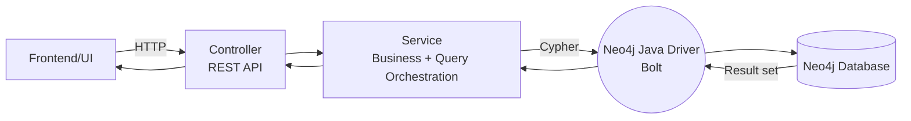

#### 1.3.7 Property Graph và RDF (tham khảo mở rộng)

Hai mô hình dữ liệu đồ thị phổ biến:
- **Property Graph (Neo4j)**: node/relationship có properties và label/type.
- **RDF/Triple Store**: dữ liệu dạng bộ ba (subject–predicate–object), thường dùng trong semantic web.

Trong đồ án, property graph phù hợp hơn vì:
- Dễ biểu diễn node theo loại (Email/URL/IP).
- Dễ lưu thuộc tính phục vụ demo (`riskScore`, `verdict`, `layoutX/Y`).

#### 1.3.8 Tối ưu truy vấn (khái quát)

Một số nguyên tắc khi viết Cypher để tránh truy vấn nặng:
- Bắt đầu từ node có điều kiện lọc rõ (theo label hoặc property có index).
- Giới hạn phạm vi traversal (ví dụ chỉ 2-hop/3-hop cần thiết).
- Tránh `MATCH (n)` không điều kiện trên đồ thị lớn.
- Dùng aggregation hợp lý và kiểm soát `collect()`.

---

### 1.4 So sánh mô hình ER và mô hình Graph

#### 1.4.1 Mô hình ER trong CSDL quan hệ

**Mô hình ER (Entity–Relationship)** mô tả dữ liệu ở mức khái niệm bằng thực thể, thuộc tính và mối quan hệ. Khi triển khai sang RDBMS, các quan hệ N–N thường cần bảng trung gian.

**Các thành phần và ký hiệu cơ bản** (theo mô tả khái quát):
- Entity: hình chữ nhật → bảng.
- Attribute: hình oval → cột.
- Relationship: hình thoi → thường được hiện thực bằng khóa ngoại hoặc bảng trung gian.

**Quy tắc ánh xạ sang CSDL quan hệ (Implementation Mapping)**
- Entity → Table
- Attribute → Column
- Relationship 1–N → FK đặt ở phía N
- Relationship N–N → Table trung gian (join table) gồm 2 FK

> Với bài toán đồ án (Email–URL–IP), quan hệ thường là N–N, do đó nếu ở RDBMS sẽ cần nhiều join table.

#### 1.4.2 Mô hình Graph tương đương

Trong mô hình Graph (Property Graph):
- `Email`, `URL`, `IPAddress` là node.
- Quan hệ là relationship có hướng:
  - `(:Email)-[:CONTAINS_LINK]->(:URL)`
  - `(:Email)-[:SENT_FROM]->(:IPAddress)`
  - `(:URL)-[:HOSTED_BY]->(:IPAddress)`

Sơ đồ minh họa:

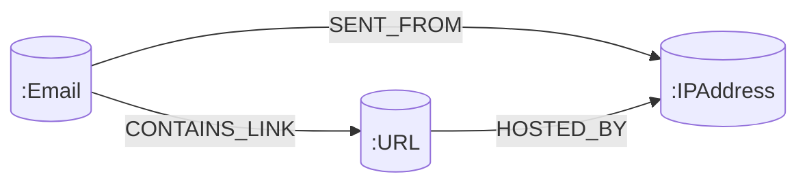

#### 1.4.3 Nhận xét và so sánh

- Ở RDBMS, truy vấn multi-hop thường cần nhiều JOIN → kế hoạch truy vấn phức tạp và có thể tạo nhiều dữ liệu trung gian.
- Ở Graph DB, truy vấn pattern được mô tả trực tiếp và duyệt theo cạnh.

Phần so sánh hiệu năng lý thuyết JOIN vs traversal được trình bày chi tiết ở Chương 6.

---

## CHƯƠNG 2: PHÂN TÍCH BÀI TOÁN MINH HỌA

### 2.1 Giới thiệu bài toán phát hiện gian lận/phishing

Phishing/scam thường không chỉ đến từ một dấu hiệu đơn lẻ (một URL lạ, một email lạ), mà thể hiện qua **chuỗi liên kết hành vi** và **tần suất dùng chung** trong một mạng lưới: nhiều email trỏ cùng URL (campaign), nhiều email xuất phát từ cùng IP (hạ tầng gửi), nhiều URL cùng host trên một IP (hub hosting).

Đồ án chọn mô hình tối giản Email–URL–IP để:
- Dễ minh họa quan hệ và pattern.
- Dễ trình bày ưu thế graph traversal.
- Dễ mở rộng về sau.

#### 2.1.1 Động cơ lựa chọn bài toán

Trong thực tế, một chiến dịch phishing có thể có nhiều biến thể: thay đổi email gửi, thay đổi URL, thay đổi hạ tầng IP/hosting. Khi nhìn từng thực thể riêng lẻ, rất khó kết luận. Tuy nhiên, nếu nhìn trên “bản đồ liên kết”, ta có thể thấy các dấu hiệu:
- Nhiều Email cùng trỏ về một URL (campaign phát tán).
- Nhiều Email cùng gửi từ một IP (hạ tầng spam/botnet).
- Nhiều URL cùng host trên một IP (hosting hub).

Đây là lý do nhóm chúng em chọn Graph Database: truy vấn và giải thích các liên kết sẽ trực quan hơn.

#### 2.1.2 Phạm vi bài toán trong đồ án

Phạm vi đồ án được giới hạn để phục vụ mục tiêu học tập và demo:
- Chỉ mô hình hóa 3 loại node: `Email`, `URL`, `IPAddress`.
- Chỉ mô hình hóa 3 loại relationship: `CONTAINS_LINK`, `SENT_FROM`, `HOSTED_BY`.
- Phần phân tích rủi ro hiện tại **dựa trên các luật/heuristic (rule-based)** khai thác trực tiếp **cấu trúc liên kết** của đồ thị (truy vấn Cypher + thống kê shared URL/shared IP/triad…). Theo nghĩa này, hệ thống “ra quyết định theo rules” trên graph, nhưng **không phải** một mô hình **Machine Learning** theo nghĩa huấn luyện/tối ưu tham số từ dữ liệu.

Lưu ý: **Graph Database** là nền tảng lưu trữ và truy vấn quan hệ; các kỹ thuật **ML trên đồ thị** (ví dụ Graph Data Science, Graph Neural Networks) là hướng mở rộng có thể tích hợp ở giai đoạn sau.

Các mở rộng (ngoài phạm vi hiện tại) sẽ được đề xuất ở phần hướng phát triển.

#### 2.1.3 Dữ liệu đầu vào và giả định

Dữ liệu đầu vào được nhập qua API (dạng demo), gồm các chuỗi:
- Email: ví dụ `scam@test.com`
- URL: ví dụ `http://fake-bank.com`
- IP: ví dụ `192.168.1.10`

Hệ thống chuẩn hóa định danh theo quy ước:
- `Email:<value>`
- `URL:<value>`
- `IPAddress:<value>`

Mục tiêu của quy ước này là tránh trùng node khi ingest và làm rõ “một thực thể – một node”.

### 2.2 Phân tích yêu cầu hệ thống

#### 2.2.1 Yêu cầu chức năng

1) **Ingest dữ liệu**
- Tạo graph đầy đủ: `GET/POST /api/graph/link?email=...&url=...&ip=...`
- Tạo graph từng phần: `GET /api/graph/link-partial?email=...&url=...&ip=...`

2) **Phân tích rủi ro (rule-based)**
- Chạy phân tích tổng quan và cập nhật node: `GET /api/graph/analyze`

Ngoài ra, hệ thống còn có nhóm API phân tích chi tiết theo từng loại node:
- `GET /api/graph/analysis/email-risk`
- `GET /api/graph/analysis/url-risk`
- `GET /api/graph/analysis/ip-risk`

Ghi chú: nhóm `/api/graph/analyze` dùng quy ước `verdict` (SAFE/SUSPICIOUS/FRAUD/UNKNOWN) và áp dụng triad-gating; nhóm `/api/graph/analysis/*` trả về các trường `riskLevel`, `indicators` và nhãn verdict tiếng Việt phục vụ phân tích chi tiết.

3) **Cung cấp dữ liệu cho trực quan hóa**
- Lấy dữ liệu graph: `GET /api/graph/full`
- (Tùy chọn theo UI) Lưu layout sau kéo thả: `POST /api/graph/layout/save`

4) **Báo cáo/tổng hợp**
- Trang report hiển thị thống kê verdict/score và xuất CSV/in.

#### 2.2.2 Yêu cầu phi chức năng

- Dễ triển khai demo, dễ thao tác.
- Cấu hình kết nối Neo4j qua biến môi trường (tránh lộ mật khẩu).
- Tính nhất quán dữ liệu: tránh tạo node/relationship trùng (sử dụng `MERGE`).
- Tránh lộ thông tin nhạy cảm: cấu hình Neo4j bằng biến môi trường.
- Khả năng quan sát: có endpoint health check và report để dễ demo.

### 2.3 Xác định thực thể và mối quan hệ

#### 2.3.1 Thực thể Email
- Ý nghĩa: điểm khởi đầu của kịch bản.
- Định danh: `Email:<value>`.

#### 2.3.2 Thực thể URL
- Ý nghĩa: liên kết xuất hiện trong email.
- Định danh: `URL:<value>`.

#### 2.3.3 Thực thể IPAddress
- Ý nghĩa: hạ tầng gửi/host.
- Định danh: `IPAddress:<value>`.

#### 2.3.4 Các loại Relationship
- `CONTAINS_LINK`: Email chứa URL
- `SENT_FROM`: Email gửi từ IP
- `HOSTED_BY`: URL host trên IP

### 2.4 Mô hình nghiệp vụ tổng quát (Flow)

**Flow tổng quát**:
1) Thêm dữ liệu (tạo node/relationship)
2) Chạy phân tích (`/api/graph/analyze`) → cập nhật `riskScore` + `verdict`
3) UI hiển thị graph và report

Sơ đồ luồng tổng quát:

> **Hình 2.1**: Luồng nghiệp vụ tổng quát (Ingest → Analyze → Trực quan hóa/Report).

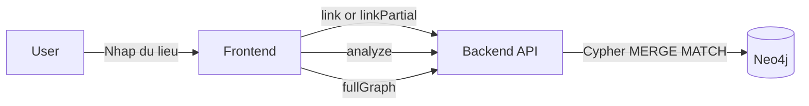

**Nguyên tắc quan trọng (khớp code)**:
- Một thực thể được xem là có ngữ cảnh tối thiểu khi tham gia đủ **triad (tam giác Email–URL–IP)**.
- Nếu chưa đủ triad: hệ thống giữ `verdict=UNKNOWN`, `riskScore=0` để tránh kết luận khi thiếu ngữ cảnh.

**Diễn giải chi tiết cơ chế triad-gating**: Trong đồ án, dữ liệu đầu vào có thể được nhập **không đầy đủ** (ví dụ chỉ có Email+URL hoặc Email+IP khi người dùng đang demo nhanh). Nếu chấm điểm ngay trên dữ liệu rời rạc, hệ thống dễ đưa ra kết luận “đáng nghi” dựa trên một mẩu thông tin chưa đủ bối cảnh. Vì vậy, nhóm áp dụng nguyên tắc “đủ ngữ cảnh tối thiểu” theo **triad**:

- **Triad** được hiểu là chuỗi liên kết khép kín Email–URL–IPAddress, phản ánh một kịch bản hành vi hoàn chỉnh (Email chứa link, Email xuất phát từ IP, và URL được host trên IP đó). Khi triad tồn tại, các rule như shared URL/shared IP/đếm liên kết mới có ý nghĩa hơn để suy luận rủi ro.
- Nếu **chưa đủ triad**, hệ thống chủ động **không kết luận** (giữ `verdict=UNKNOWN`, `riskScore=0`) để tránh “gán nhãn sai” do thiếu dữ liệu. Điều này cũng giúp demo nhất quán: ingest là bước tạo liên kết, còn verdict/score chỉ có sau khi đủ bối cảnh và chạy analyze.
- Về luồng API, quy tắc này liên hệ trực tiếp với các endpoint:
  - `/api/graph/link` tạo đủ 3 cạnh nên thường tạo được triad ngay.
  - `/api/graph/link-partial` có thể tạo dữ liệu một phần (orphan/partial) nên có thể chưa đủ triad.
  - `/api/graph/analyze` sẽ kiểm tra điều kiện triad trước khi chấm điểm và cập nhật `riskScore`/`verdict`.

#### 2.4.1 Tiêu chí “đủ ngữ cảnh” (triad)

Trong hệ thống, một Email được xem là có triad khi tồn tại đồng thời:
- `(:Email)-[:CONTAINS_LINK]->(:URL)`
- `(:Email)-[:SENT_FROM]->(:IPAddress)`
- `(:URL)-[:HOSTED_BY]->(:IPAddress)` với cùng IPAddress ở hai nhánh

Triad giúp đảm bảo “chuỗi hành vi” hoàn chỉnh Email → URL → IP và tránh việc gán nhãn khi chỉ có dữ liệu rời rạc.

### 2.5 Các kịch bản nghiệp vụ minh họa

Để thuyết trình/demo rõ giá trị của Graph DB, nhóm chúng em xây dựng các kịch bản tối thiểu nhưng có ý nghĩa:

#### 2.5.1 Kịch bản A: Một chuỗi đơn lẻ (single triad)

- Mô tả: 1 Email chứa 1 URL và được gửi từ 1 IP; URL host trên đúng IP đó.
- Ý nghĩa: chứng minh hệ thống mô hình hóa được chuỗi Email → URL → IP.
- Kỳ vọng: sau analyze, Email đủ triad sẽ có `hasTriad=true` và được gán verdict theo score.

#### 2.5.2 Kịch bản B: Shared URL (phishing campaign)

- Mô tả: nhiều Email khác nhau cùng trỏ tới một URL.
- Ý nghĩa: biểu hiện “campaign phát tán” (một link được gửi hàng loạt).
- Kỳ vọng: URL có thể tăng score ở nhánh phân tích tổng quan; nhóm `/analysis/url-risk` cho thấy `emailCount` tăng và indicator `URL_DUOC_NHIEU_EMAIL_TRO_TOI`.

#### 2.5.3 Kịch bản C: Shared IP (hạ tầng gửi tập trung)

- Mô tả: nhiều Email được gửi từ cùng một IP.
- Ý nghĩa: biểu hiện hạ tầng spam/botnet hoặc hệ thống gửi hàng loạt.
- Kỳ vọng: IP có thể tăng score theo rule shared IP; nhóm `/analysis/ip-risk` cho thấy `emailCount` tăng và indicator `IP_DUNG_BOI_NHIEU_EMAIL`.

#### 2.5.4 Kịch bản D: Dữ liệu thiếu triad (để thấy UNKNOWN)

- Mô tả: người dùng chỉ nhập Email+URL hoặc Email+IP.
- Ý nghĩa: chứng minh cơ chế triad-gating giúp tránh kết luận khi thiếu ngữ cảnh.
- Kỳ vọng: `/api/graph/analyze` trả về `hasTriad=false` và `verdict=UNKNOWN` cho Email tương ứng.

### 2.6 Tiêu chí đánh giá (Acceptance Criteria)

Các tiêu chí để xem hệ thống đạt mục tiêu đồ án:

1) **Đúng mô hình**
- Ingest tạo đúng node/relationship, không trùng dữ liệu khi gọi lại cùng input.

2) **Đúng truy vết/pattern**
- Truy vấn Email → URL → IP trả đúng chuỗi liên kết.
- Shared URL/shared IP phản ánh được tần suất dùng chung.

3) **Đúng phân tích tổng quan (triad-gating)**
- Node chưa đủ triad giữ UNKNOWN.
- Node đủ triad có verdict và score nhất quán với luật.

4) **Đúng trải nghiệm demo**
- UI hiển thị được graph, lọc được theo verdict/type, xem được thông tin node.
- Trang report thống kê được theo verdict.

### 2.7 Các tình huống biên và cách xử lý

#### 2.7.1 Dữ liệu trùng lặp

Khi người dùng gọi ingest nhiều lần với cùng Email/URL/IP, hệ thống dùng `MERGE` để:
- Không tạo trùng node.
- Không tạo trùng relationship.

#### 2.7.2 Dữ liệu rời rạc (orphan nodes)

**Orphan nodes** là các node (Email/URL/IPAddress) tồn tại trên graph nhưng **thiếu một hoặc nhiều relationship cần thiết** để tạo thành ngữ cảnh tối thiểu (triad). Tình huống này thường xảy ra trong demo khi:

- Người dùng gọi `/api/graph/link-partial` với **1–2 tham số** (ví dụ chỉ Email+URL hoặc chỉ URL+IP).
- Dữ liệu đầu vào bị thiếu/nhập sai (ví dụ email rỗng, URL thiếu schema…), nên chỉ tạo được một phần liên kết.
- Chưa chạy đủ các bước ingest để “khép” chuỗi Email–URL–IP.

**Hệ quả** của dữ liệu rời rạc:
- Nếu chấm điểm ngay trên dữ liệu thiếu bối cảnh, kết luận dễ bị lệch (ví dụ URL “lạ” nhưng thực tế chưa biết nó liên kết với email nào/IP nào).
- Một số thống kê/pattern (triad, shared URL/shared IP theo ngữ cảnh chiến dịch) sẽ không phản ánh đúng ý nghĩa vì graph chưa đủ cạnh.
- UI có thể vẫn hiển thị node, nhưng khó giải thích “vì sao đáng nghi” nếu thiếu đường đi liên kết.

**Cách xử lý trong hệ thống hiện tại (khớp code)**:
- Áp dụng **triad-gating**: nếu một thực thể chưa tham gia đủ triad, hệ thống **không kết luận** để tránh false positive.
- Vì vậy, khi chạy `/api/graph/analyze`, các node chưa đủ ngữ cảnh sẽ được giữ `verdict=UNKNOWN` và `riskScore=0`.

**Cách khắc phục khi demo/kiểm thử**:
- Nếu muốn có kết quả phân tích rõ ràng, ưu tiên ingest bằng `/api/graph/link` (đủ 3 tham số) hoặc gọi bổ sung các lần `/api/graph/link-partial` còn thiếu để hình thành triad, sau đó chạy lại `/api/graph/analyze`.

#### 2.7.3 Dữ liệu “lệch” (URL host khác IP gửi)

Trong kịch bản thực tế, URL trong email có thể host trên IP khác IP gửi email. Với mô hình hiện tại, triad được định nghĩa theo tam giác cùng IP (để minh họa rõ ràng). Đây là một giới hạn có chủ đích của demo và có thể mở rộng sau (ví dụ chuyển sang triad mềm: Email–URL và URL–IP là đủ).

---

## CHƯƠNG 3: PHÂN TÍCH HỆ THỐNG

### 3.1 Xác định Actor

- **Người dùng (User)**: nhập dữ liệu demo, chạy phân tích, xem trực quan hóa.

### 3.2 Biểu đồ Use Case

Các use case chính:
- UC1: Thêm dữ liệu vào Graph
- UC2: Chạy phân tích rủi ro
- UC3: Xem đồ thị trực quan
- UC4: Lọc dữ liệu
- UC5: Xem chi tiết node
- UC6 (tùy chọn): Lưu layout sau kéo thả

Minh họa (dạng sơ đồ chức năng):

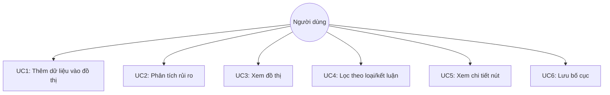

#### 3.2.1 User stories (tóm tắt)

- US1: Là người dùng, tôi muốn nhập Email/URL/IP nhanh để tạo đồ thị demo.
- US2: Tôi muốn chạy phân tích để node đổi màu và có verdict/score.
- US3: Tôi muốn lọc để tập trung vào các node đáng nghi.
- US4: Tôi muốn bấm vào node để xem lý do/quan hệ liên quan.
- US5: Tôi muốn lưu bố cục sau kéo thả để lần sau mở lại giữ nguyên.

### 3.3 Mô tả chi tiết Use Case

#### 3.3.1 UC1 – Thêm dữ liệu vào Graph

| Thuộc tính | Mô tả |
|---|---|
| Tên và mã Use Case | UC1 – Thêm dữ liệu vào Graph |
| Mô tả | Tạo node và relationship trong Neo4j từ dữ liệu đầu vào. Hệ thống sử dụng Cypher `MERGE` nên gọi lặp với cùng dữ liệu sẽ không tạo trùng node/relationship. |
| Tác nhân chính | Người dùng (UI) hoặc API caller (curl/Postman). |
| Tiền điều kiện | Neo4j đang hoạt động; backend Spring Boot đang chạy (kiểm tra nhanh qua `GET /api/graph/health`). |
| Hậu điều kiện | Dữ liệu được ghi vào Neo4j dưới dạng node (`Email/URL/IPAddress`) và relationship tương ứng. |
| Input | Các tham số query (string):<br>- `email`: có thể có/không tùy endpoint<br>- `url`: có thể có/không tùy endpoint<br>- `ip`: có thể có/không tùy endpoint |
| API sử dụng | - `GET/POST /api/graph/link?email=...&url=...&ip=...` (bắt buộc đủ 3 tham số).<br>- `GET /api/graph/link-partial?email=...&url=...&ip=...` (tùy chọn 1–3 tham số). |
| Output | - Với `/link`: trả chuỗi xác nhận dạng `Graph linked OK: <email> → <url> → <ip>` (HTTP 200).<br>- Với `/link-partial`: trả JSON, ví dụ:<br>&nbsp;&nbsp;• đủ 3 tham số → `{status:"ok", nodes:[...], relationships:[...]}`<br>&nbsp;&nbsp;• nhập thiếu → `{status:"ok_partial", nodes:[...], relationships:[...], message:"..."}`<br>&nbsp;&nbsp;• không nhập gì → `{status:"no_input", message:"Nhập ít nhất 1 trong 3: email/url/ip"}` |
| Luồng chính | 1) Client chọn endpoint phù hợp:<br>&nbsp;&nbsp;• Nếu đã có đủ `email,url,ip` → gọi `/api/graph/link` (GET hoặc POST).<br>&nbsp;&nbsp;• Nếu có thể thiếu trường → gọi `/api/graph/link-partial` (GET).<br>2) Backend nhận tham số và chuẩn hóa (trim).<br>3) Backend chạy Cypher `MERGE` để tạo node (Email/URL/IPAddress) và tạo relationship theo dữ liệu có sẵn:<br>&nbsp;&nbsp;• `Email-[:CONTAINS_LINK]->URL` (khi có Email+URL)<br>&nbsp;&nbsp;• `Email-[:SENT_FROM]->IPAddress` (khi có Email+IP)<br>&nbsp;&nbsp;• `URL-[:HOSTED_BY]->IPAddress` (khi có URL+IP)<br>4) Backend trả response theo endpoint. |
| Luồng phụ / kiểm tra hợp lệ | A1) Gọi `/link` nhưng thiếu tham số bắt buộc → Spring trả HTTP 400 (thiếu `@RequestParam`).<br>A2) Gọi `/link-partial` với 1–2 tham số → vẫn tạo dữ liệu một phần và trả `status=ok_partial`.<br>A3) Gọi `/link-partial` không có tham số nào → trả `status=no_input`. |
| Kết quả mong đợi | Dữ liệu không trùng lặp (nhờ `MERGE`); graph sau ingest có thể được xem trên UI thông qua UC3. |
| Ghi chú | `riskScore/verdict` chưa phản ánh ngay sau ingest; cần UC2 (`/api/graph/analyze`) để cập nhật điểm/kết luận. |

#### 3.3.2 UC2 – Chạy phân tích rủi ro

| Thuộc tính | Mô tả |
|---|---|
| Tên và mã Use Case | UC2 – Chạy phân tích rủi ro |
| Mô tả | Chạy chấm điểm rủi ro theo rule + triad-gating và cập nhật thuộc tính `riskScore`/`verdict` lên **cả 3 loại node**: Email, URL, IPAddress. |
| Tác nhân chính | Người dùng (curl/Postman) hoặc frontend (UI/report gọi tự động khi tải trang). |
| Tiền điều kiện | Graph đã có dữ liệu; Neo4j kết nối OK. |
| Input | Không có body; chỉ gọi `GET /api/graph/analyze`. |
| API sử dụng | - `GET /api/graph/analyze` (chấm điểm + cập nhật property).<br>- (Tùy chọn, xem chi tiết) `GET /api/graph/analysis/email-risk`, `.../url-risk`, `.../ip-risk` (trả bảng phân tích/indicator để tham khảo). |
| Output | Trả JSON list (kết quả cho Email), mỗi phần tử gồm: `email` (id), `score`, `verdict`, `hasTriad`. |
| Luồng chính | 1) Client gọi `GET /api/graph/analyze`.<br>2) Backend chấm điểm Email:<br>&nbsp;&nbsp;2.1) Tính `hasTriad` (Email tham gia đủ tam giác Email–URL–IP).<br>&nbsp;&nbsp;2.2) Nếu `hasTriad=false` → gán `score=0`, `verdict=UNKNOWN`.<br>&nbsp;&nbsp;2.3) Nếu `hasTriad=true` → cộng điểm theo rule: có URL (+30), có IP (+20), shared IP (+30), shared URL (+30), tối đa 100.<br>&nbsp;&nbsp;2.4) Gán verdict theo ngưỡng: `SAFE` (0), `SUSPICIOUS` (0<score<60), `FRAUD` (>=60).<br>3) Backend chấm điểm IP và URL (trong cùng request): shared (được nhiều Email sử dụng) → tăng điểm và gán verdict theo ngưỡng; nếu không đủ triad → UNKNOWN.<br>4) Backend `SET` các thuộc tính `riskScore` và `verdict` lên node trong Neo4j và trả danh sách kết quả cho Email. |
| Luồng phụ | A1) Graph rỗng → trả `[]`.<br>A2) Nếu một Email thiếu 1 cạnh trong triad (Email–URL, Email–IP hoặc URL–IP) → `hasTriad=false` và giữ UNKNOWN. |
| Kết quả mong đợi | Sau khi chạy xong, mở lại UI/report sẽ thấy node được tô màu theo `verdict` và hiển thị `riskScore` đúng theo rule. |
| Ghi chú | `/api/graph/analyze` không trả thống kê tổng theo verdict; trang report/UI sẽ tự tổng hợp từ dữ liệu `/api/graph/full`. Với URL/IP, score tối đa theo rule hiện tại thường nhỏ (ví dụ shared cho +30), nên verdict thường rơi vào SAFE/SUSPICIOUS/UNKNOWN. |

#### 3.3.3 UC3 – Xem đồ thị trực quan

| Thuộc tính | Mô tả |
|---|---|
| Tên và mã Use Case | UC3 – Xem đồ thị trực quan |
| Mô tả | Hiển thị toàn bộ graph (nodes + links) trên giao diện (D3.js force-directed graph) và cho phép tương tác: zoom/pan, hover/click node, kéo thả node. |
| Tác nhân chính | Người dùng (end-user). |
| Tiền điều kiện | Backend đang chạy; graph có dữ liệu (có thể tạo bằng UC1). |
| Hậu điều kiện | Graph được hiển thị trên UI; node được tô màu theo verdict (nếu đã analyze). |
| API sử dụng | `GET /api/graph/analyze` → `GET /api/graph/full` → `GET /api/graph/health`. |
| Luồng chính | 1) User mở trang `http://localhost:8080/` (hoặc bấm Refresh).<br>2) UI gọi `GET /api/graph/analyze` để cập nhật `riskScore/verdict` mới nhất.<br>3) UI gọi `GET /api/graph/full` để lấy `nodes` và `links` cho D3 render.<br>4) UI gọi `GET /api/graph/health` để hiển thị trạng thái Neo4j và counts.<br>5) UI render đồ thị, tô màu theo verdict; bật zoom/pan; cho phép hover/click để xem panel chi tiết. |
| Luồng phụ | Nếu graph chưa có dữ liệu: UI hiển thị thông điệp hướng dẫn dùng “Seed demo” hoặc “Link” để tạo nhanh. |
| Kết quả mong đợi | Đồ thị trực quan rõ ràng, dễ quan sát pattern (shared URL/shared IP) sau khi analyze. |
| Ghi chú | UC3 phụ thuộc dữ liệu từ `/api/graph/full`; verdict/score lấy từ thuộc tính đã được UC2 cập nhật vào Neo4j. |

#### 3.3.4 UC4 – Lọc dữ liệu

| Thuộc tính | Mô tả |
|---|---|
| Tên và mã Use Case | UC4 – Lọc dữ liệu |
| Mô tả | Tập trung vào tập con dữ liệu theo loại node hoặc verdict để nhìn rõ các cụm đáng nghi. |
| Tác nhân chính | Người dùng. |
| Tiền điều kiện | Graph đang hiển thị trên UI (UC3 đã tải `nodes/links`). |
| Hậu điều kiện | UI chỉ hiển thị các node/edge thỏa mãn bộ lọc. |
| Input | Thao tác bật/tắt filter trên UI:<br>- Theo loại node: Email / URL / IPAddress<br>- Theo verdict: SAFE / SUSPICIOUS / FRAUD / UNKNOWN |
| API sử dụng | Không có API riêng cho lọc. Dữ liệu lọc lấy từ bộ dữ liệu đã tải bằng `GET /api/graph/full` (UC3). |
| Output | Đồ thị được render lại theo subset sau lọc (nodes + links liên quan). |
| Luồng chính | 1) Người dùng bật/tắt các filter: Email/URL/IP và SAFE/SUSPICIOUS/FRAUD/UNKNOWN.<br>2) UI lọc dữ liệu **client-side** (không gọi API mới) và cập nhật lại đồ thị theo subset tương ứng. |
| Luồng phụ | A1) Bỏ lọc (bật lại tất cả) → hiển thị toàn bộ graph.<br>A2) Sau khi lọc, nếu không còn node thỏa điều kiện → UI hiển thị đồ thị rỗng/không có node (không phát sinh lỗi backend). |
| Kết quả mong đợi | Người dùng nhanh chóng khoanh vùng nhóm đối tượng cần quan tâm (cụm shared URL/shared IP). |
| Ghi chú | Trong phiên bản hiện tại, lọc thực hiện hoàn toàn ở frontend, không có endpoint lọc riêng. |

#### 3.3.5 UC5 – Xem chi tiết node

| Thuộc tính | Mô tả |
|---|---|
| Tên và mã Use Case | UC5 – Xem chi tiết node |
| Mô tả | Hiển thị thông tin chi tiết node (id/type/verdict/riskScore) và các lý do/quan hệ liên quan để giải thích kết quả phân loại. |
| Tác nhân chính | Người dùng. |
| Tiền điều kiện | Graph đang hiển thị; người dùng hover/click vào node. |
| Hậu điều kiện | Panel chi tiết hiển thị thông tin và “reasons” suy ra từ quan hệ trong graph. |
| Input | Sự kiện tương tác UI:<br>- Hover node (xem nhanh)<br>- Click node (ghim/giữ panel) |
| API sử dụng | Mặc định không gọi API mới; dữ liệu chi tiết lấy từ `nodes/links` đã tải từ `GET /api/graph/full` (UC3).<br>(Tùy chọn trong UI) `DELETE /api/graph/node?id=<nodeId>` để xóa node và reload graph. |
| Output | Panel chi tiết hiển thị: `id`, `type`, `verdict`, `riskScore` và tóm tắt quan hệ liên quan (các link kề). |
| Luồng chính | 1) Người dùng hover/click node (click để “ghim”).<br>2) UI hiển thị panel chi tiết: `id`, `type`, `verdict`, `riskScore` và thống kê các cạnh (CONTAINS_LINK / SENT_FROM / HOSTED_BY).<br>3) UI suy luận “reasons” từ dữ liệu `nodes/links` (ví dụ: chưa đủ triad → UNKNOWN; URL/IP dùng chung bởi nhiều Email → tăng điểm). |
| Luồng phụ | A1) Chưa analyze hoặc thiếu triad: panel vẫn hiển thị `UNKNOWN` kèm lý do “chưa đủ triad”.<br>A2) Node không có edge kề (dữ liệu đơn lẻ) → panel vẫn hiển thị thông tin cơ bản, phần quan hệ rỗng. |
| Kết quả mong đợi | Người dùng hiểu rõ vì sao node được gán verdict/score và node liên kết với các thực thể nào. |
| Ghi chú | UI có chức năng phụ “xóa node” (nếu bật): gọi `DELETE /api/graph/node?id=<nodeId>` và reload trang. |

#### 3.3.6 UC6 – Lưu layout sau kéo thả

| Thuộc tính | Mô tả |
|---|---|
| Tên và mã Use Case | UC6 – Lưu layout sau kéo thả (tùy chọn) |
| Mô tả | Lưu vị trí (x,y) của các node sau khi người dùng kéo thả thủ công, để lần sau mở UI bố cục ổn định. |
| Tác nhân chính | Người dùng. |
| Tiền điều kiện | Graph đang hiển thị; người dùng đã di chuyển vị trí một số node; nút Save layout được bật (layoutDirty=true). |
| Hậu điều kiện | Thuộc tính `layoutX/layoutY` được lưu lên node tương ứng trong Neo4j. |
| Input | JSON array body: `[{id: "<nodeId>", x: <number>, y: <number>}, ...]`. |
| Output | JSON: `{status: "ok", saved: <n>}` hoặc `{status:"no_input"|"no_valid_rows", saved:0, message:"..."}`. |
| Luồng chính | 1) Người dùng kéo thả node → UI cập nhật tọa độ và bật trạng thái “cần lưu”.<br>2) Người dùng bấm “Save layout”.<br>3) UI gửi `POST /api/graph/layout/save` với danh sách `{id,x,y}`.<br>4) Backend lọc các dòng hợp lệ (có `id` và `x/y` là số hữu hạn) và cập nhật Neo4j: `SET n.layoutX=row.x, n.layoutY=row.y`.<br>5) Backend trả `status=ok` và `saved=<số node cập nhật>`. |
| Luồng phụ | A1) Không bấm save → layout không được lưu xuống DB.<br>A2) Body rỗng → trả `status=no_input`.<br>A3) Không có dòng hợp lệ (thiếu id hoặc x/y không phải số) → trả `status=no_valid_rows`. |
| Kết quả mong đợi | Lần sau mở graph, các node giữ lại bố cục đã lưu (dựa trên `layoutX/layoutY`). |
| Ghi chú | `saved` có thể nhỏ hơn số dòng gửi lên nếu `id` không match node trong DB hoặc dữ liệu không hợp lệ. |

### 3.4 Biểu đồ Sequence

#### 3.4.1 Sequence: Ingest (tạo dữ liệu)

> **Hình 3.2**: Biểu đồ tuần tự (Sequence) cho luồng ingest – thêm dữ liệu Email/URL/IP vào Neo4j qua API.

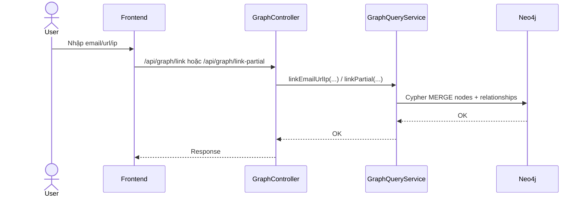

Sơ đồ cho thấy luồng xử lý ingest theo kiểu **request/response đồng bộ**: người dùng nhập dữ liệu trên UI, frontend gọi endpoint `/api/graph/link` hoặc `/api/graph/link-partial`, sau đó tầng controller chỉ đóng vai trò nhận request và chuyển tiếp logic cho service. Tầng `GraphQueryService` chịu trách nhiệm chuẩn hoá tham số và xây dựng các câu lệnh Cypher, rồi thực thi trên Neo4j. Việc dùng `MERGE` giúp ingest có tính **idempotent** (gọi lặp không tạo trùng node/relationship), phù hợp cho kịch bản demo chạy nhiều lần. Trường hợp gọi `link-partial` có thể tạo dữ liệu chưa đủ triad, vì vậy các bước phân tích tiếp theo (Analyze) sẽ áp dụng triad-gating để tránh kết luận khi thiếu ngữ cảnh.

#### 3.4.2 Sequence: Analyze (chấm điểm + gán nhãn)

> **Hình 3.3**: Biểu đồ tuần tự (Sequence) cho luồng analyze – chấm điểm rủi ro và gán nhãn (verdict) trên Neo4j.

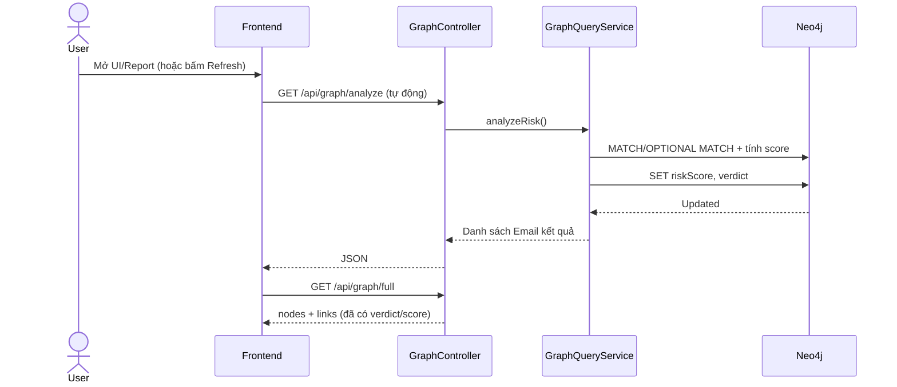

Sơ đồ mô tả cơ chế phân tích theo hướng **rule-based** chạy trên graph: frontend gọi `/api/graph/analyze` (thường tự động khi tải/refresh), controller chuyển xử lý cho service và service thực thi các truy vấn `MATCH/OPTIONAL MATCH` để lấy bối cảnh quan hệ phục vụ tính điểm. Sau khi tính `riskScore` và suy ra `verdict`, backend ghi ngược thuộc tính này lên node trong Neo4j (`SET riskScore, verdict`) để UI/report có thể dùng lại mà không cần tính lại ở phía client. Nhờ vậy, bước `GET /api/graph/full` ngay sau đó trả về `nodes + links` đã “được gắn nhãn”, giúp trực quan hoá theo màu/verdict nhất quán. Với các thực thể chưa đủ triad, analyze sẽ giữ `UNKNOWN` để tránh kết luận khi thiếu ngữ cảnh.

### 3.5 Biểu đồ hoạt động (Activity Diagram)

Biểu đồ hoạt động mô tả luồng thao tác chính của người dùng khi demo:

> **Hình 3.5**: Biểu đồ hoạt động (Activity) cho kịch bản demo – tạo dữ liệu, vẽ graph ban đầu và (tuỳ chọn) phân tích khi người dùng bấm Analyze để cập nhật đồ thị/report.

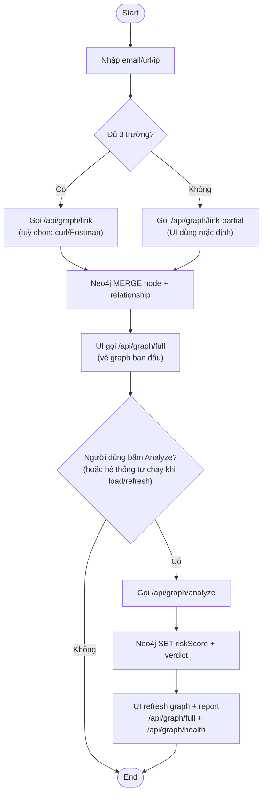

Biểu đồ nhấn mạnh chu trình demo gồm hai pha tách bạch: (1) **ingest** để tạo node/relationship và (2) **analyze** để tính điểm/gán nhãn. Sau khi ingest, UI có thể gọi `/api/graph/full` để vẽ “graph ban đầu” (chưa/ít gắn nhãn), sau đó **chỉ khi có hành động Analyze** thì backend mới chạy chấm điểm và ghi `riskScore/verdict` lên Neo4j (`SET riskScore, verdict`). Cuối cùng, UI **refresh** lại graph/report bằng cách gọi lại `/api/graph/full` và `/api/graph/health` để hiển thị màu/verdict đúng theo kết quả mới.

Ghi chú triển khai: trong phiên bản hiện tại, bước Analyze có thể được kích hoạt **tự động khi người dùng tải/refresh trang** (tương đương “bấm Analyze” trong kịch bản demo). Vì vậy, cùng một sơ đồ vẫn mô tả đúng bản chất: phải có một “tác nhân kích hoạt” để `/api/graph/analyze` chạy, sau đó UI lấy dữ liệu mới nhất để render.

### 3.6 Sơ đồ luồng dữ liệu (Data Flow)

Ở mức khái quát, hệ thống có 3 luồng dữ liệu chính:

1) **Ingest**: Client gửi input (email/url/ip) → Backend chuyển thành Cypher `MERGE` → Neo4j lưu node/cạnh.
2) **Analyze**: Client gọi analyze → Backend truy vấn thống kê lân cận + triad → Neo4j cập nhật thuộc tính verdict/score.
3) **Visualize**: Client gọi full graph → Backend trả JSON nodes/links → D3 hiển thị.

> **Hình 3.6**: Sơ đồ luồng dữ liệu (DFD) mức khái quát – dữ liệu đi từ người dùng qua API tới Neo4j và quay lại UI.

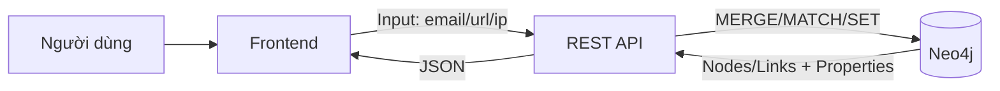

Sơ đồ cho thấy Neo4j đóng vai trò **nguồn dữ liệu trung tâm** cho cả ingest lẫn analyze, trong khi frontend chỉ giao tiếp qua REST API. Backend chuyển đổi input thành các thao tác Cypher (MERGE/MATCH/SET) và chuẩn hoá đầu ra thành JSON để UI render. Việc “ghi thuộc tính phân tích” (score/verdict) trực tiếp lên node giúp vòng lặp visualize đơn giản: UI chỉ cần lấy `/full` là có đủ thông tin để tô màu và hiển thị chi tiết.

### 3.7 Ràng buộc và yêu cầu phi chức năng (bổ sung)

- **Tính nhất quán dữ liệu**: cùng một thực thể chỉ có một node (dựa trên `id` chuẩn hóa + `MERGE`).
- **Khả năng quan sát**: có `health` endpoint và trang report.
- **Tính tái lập demo**: các kịch bản ingest/analyze nên chạy lặp lại và cho kết quả giải thích được.
- **Bảo mật cấu hình**: thông tin kết nối DB (URI/username/password) không hard-code.

---

## CHƯƠNG 4: THIẾT KẾ HỆ THỐNG

### 4.1 Kiến trúc tổng thể

Kiến trúc 3 tầng:
- **Frontend**: HTML/CSS/JS + D3.js (render graph, filter, report)
- **Backend**: Spring Boot REST API
- **Database**: Neo4j Graph DB

#### 4.1.1 Sơ đồ kiến trúc (minh họa)

> **Hình 4.1**: Kiến trúc tổng thể 3 tầng (Frontend – Spring Boot API – Neo4j).

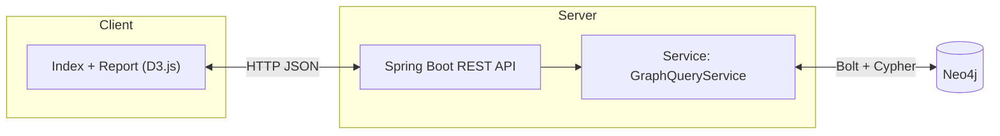

Sơ đồ thể hiện kiến trúc tối giản nhưng đúng trọng tâm của đồ án: frontend chịu trách nhiệm tương tác và trực quan hoá, backend Spring Boot cung cấp REST API, còn Neo4j lưu trữ và truy vấn dữ liệu đồ thị. Dữ liệu trao đổi giữa UI và backend là JSON qua HTTP; các thao tác với CSDL đồ thị được service thực thi bằng Cypher thông qua driver (Bolt). Cách tách tầng này giúp phần hiển thị (D3.js) không phụ thuộc vào chi tiết truy vấn, đồng thời dễ kiểm thử API bằng curl/Postman. Ngoài ra, việc gom logic truy vấn vào `GraphQueryService` giúp quản lý nhất quán các rule (triad-gating, shared URL/shared IP) và tránh trùng lặp logic ở nhiều nơi.

#### 4.1.2 Nguyên tắc thiết kế

- Đảm bảo dữ liệu không trùng: dùng `MERGE` khi ingest.
- Định danh thống nhất theo prefix (`Email:`, `URL:`, `IPAddress:`) để liên kết ổn định.
- Tách bạch:
  - API tổng quan phục vụ UI graph: `/api/graph/full`, `/api/graph/analyze`.
  - API phân tích chi tiết phục vụ báo cáo/diễn giải: `/api/graph/analysis/*`.

### 4.2 Thiết kế mô hình dữ liệu đồ thị

#### 4.2.1 Thiết kế Node

- Email node: label `Email`, properties: `id`, `value`, `riskScore`, `verdict`, (tùy chọn `layoutX/layoutY`)
- URL node: label `URL`
- IP node: label `IPAddress`

Trong triển khai hiện tại, `riskScore` và `verdict` là properties được cập nhật bởi API phân tích tổng quan `GET /api/graph/analyze`.
`layoutX/layoutY` được dùng để lưu vị trí node sau kéo thả trên UI (nếu người dùng bấm lưu).

Định danh duy nhất:
- `Email:<value>`
- `URL:<value>`
- `IPAddress:<value>`

#### 4.2.2 Thiết kế Relationship

- `CONTAINS_LINK` (Email → URL)
- `SENT_FROM` (Email → IP)
- `HOSTED_BY` (URL → IP)

#### 4.2.3 Sơ đồ Graph tổng thể

> **Hình 4.2**: Mô hình đồ thị tổng thể trong đồ án (Email–URL–IPAddress) và các relationship chính.

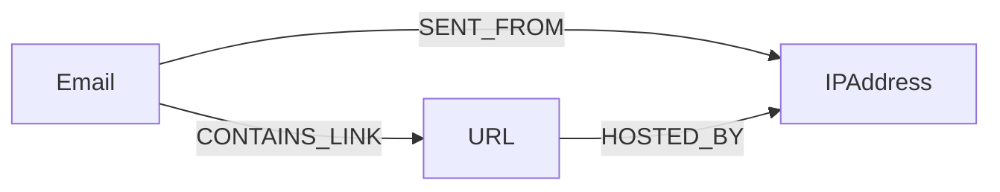

Hình minh họa cấu trúc cốt lõi mà nhóm sử dụng để demo “quan hệ là trung tâm”: Email liên kết tới URL và IP nguồn, đồng thời URL được ánh xạ tới IP hosting. Với mô hình này, các truy vấn truy vết (Email → URL → IP) và các pattern dùng chung (shared URL/shared IP) có thể biểu diễn trực tiếp bằng Cypher. Ba loại relationship được chọn vừa đủ để tạo ngữ cảnh triad phục vụ triad-gating, giúp hệ thống tránh kết luận khi dữ liệu chưa đầy đủ. Khi cần mở rộng về sau, mô hình vẫn cho phép thêm node/relationship mới (ví dụ Domain, ASN, UserAgent) mà không phá vỡ cấu trúc hiện có.

#### 4.2.4 Từ điển dữ liệu (Data Dictionary)

Để báo cáo thống nhất với triển khai, nhóm mô tả các thuộc tính chính như sau.

**A) Node `Email`**

| Thuộc tính | Kiểu | Ý nghĩa | Nguồn cập nhật |
|---|---|---|---|
| `id` | string | Định danh duy nhất: `Email:<value>` | Ingest (`MERGE`) |
| `value` | string | Email thô | Ingest |
| `riskScore` | number | Điểm rủi ro (0–100) | `/api/graph/analyze` |
| `verdict` | string | SAFE/SUSPICIOUS/FRAUD/UNKNOWN | `/api/graph/analyze` |
| `layoutX`, `layoutY` | number | Tọa độ layout (tùy chọn) | `/api/graph/layout/save` |

**B) Node `URL`**

| Thuộc tính | Kiểu | Ý nghĩa | Nguồn cập nhật |
|---|---|---|---|
| `id` | string | `URL:<value>` | Ingest |
| `value` | string | URL thô | Ingest |
| `riskScore` | number | Điểm rủi ro (0–100) | `/api/graph/analyze` |
| `verdict` | string | SAFE/SUSPICIOUS/FRAUD/UNKNOWN | `/api/graph/analyze` |
| `layoutX`, `layoutY` | number | Tọa độ layout (tùy chọn) | `/api/graph/layout/save` |

**C) Node `IPAddress`**

| Thuộc tính | Kiểu | Ý nghĩa | Nguồn cập nhật |
|---|---|---|---|
| `id` | string | `IPAddress:<value>` | Ingest |
| `value` | string | IP thô | Ingest |
| `riskScore` | number | Điểm rủi ro (0–100) | `/api/graph/analyze` |
| `verdict` | string | SAFE/SUSPICIOUS/FRAUD/UNKNOWN | `/api/graph/analyze` |
| `layoutX`, `layoutY` | number | Tọa độ layout (tùy chọn) | `/api/graph/layout/save` |

**D) Relationship types**

| Relationship | Hướng | Ý nghĩa |
|---|---|---|
| `CONTAINS_LINK` | Email → URL | Email chứa URL |
| `SENT_FROM` | Email → IPAddress | Email gửi từ IP |
| `HOSTED_BY` | URL → IPAddress | URL host trên IP |

**Ghi chú về ý nghĩa `riskScore` trong hệ thống**

- `riskScore` **lưu trên node** (node property) được cập nhật bởi `GET /api/graph/analyze` theo luật chấm điểm và **thang 0–100** (có triad-gating).
- Nhóm API `GET /api/graph/analysis/*` trả về một trường `riskScore` khác: đây là **điểm thống kê** (ví dụ tổng số liên kết hoặc số thực thể liên quan) dùng để phân loại `riskLevel` và sinh `indicators`. Trường này **không thay thế** `riskScore` đã lưu trên node.

### 4.3 Thiết kế thuật toán phân tích rủi ro (rule-based)

Mục tiêu của thuật toán trong đồ án là **gán nhãn rủi ro để phục vụ trực quan hoá** (tô màu node, hiển thị trạng thái trong report) thay vì “chẩn đoán gian lận” theo nghĩa tuyệt đối. Do đó, thuật toán được thiết kế theo hướng:

- **Đơn giản, giải thích được**: mỗi thành phần điểm tương ứng một dấu hiệu quan sát được từ cấu trúc đồ thị.
- **Thận trọng khi thiếu ngữ cảnh** (triad-gating): nếu một thực thể chưa có đủ quan hệ tối thiểu, hệ thống giữ `verdict=UNKNOWN` để tránh kết luận từ dữ liệu rời rạc.
- **Có tính bền vững**: kết quả `riskScore`/`verdict` được **ghi trực tiếp lên node** trong Neo4j để UI chỉ cần gọi `/api/graph/full` là có dữ liệu “đã gắn nhãn”.

Trong triển khai, `GET /api/graph/analyze` (hàm `analyzeRisk()`) thực hiện **3 lượt phân tích** và cập nhật cho cả 3 loại node: `Email`, `IPAddress`, `URL`.

#### 4.3.1 Nguyên tắc chấm điểm

Với rule-based, “điểm rủi ro” được suy ra từ các **mối quan hệ cục bộ** quanh node. Ý tưởng cốt lõi là: các mối liên hệ **lặp lại theo cụm** (nhiều Email dùng chung IP hoặc cùng trỏ tới một URL) thường là dấu hiệu của chiến dịch spam/phishing; ngược lại, một liên kết đơn lẻ và không đủ ngữ cảnh thì không nên kết luận.

Các thành phần điểm (đúng theo triển khai) gồm:

- Dấu hiệu **có URL** trong Email (`CONTAINS_LINK`).
- Dấu hiệu **có IP nguồn** (`SENT_FROM`).
- Dấu hiệu **shared IP**: tồn tại IP mà nhiều Email cùng gửi từ đó.
- Dấu hiệu **shared URL**: tồn tại URL mà nhiều Email cùng trỏ tới.

**Triad-gating (ngữ cảnh tối thiểu)**

Thay vì chấm điểm ngay khi có một quan hệ lẻ, hệ thống yêu cầu một Email (hoặc một URL/IP) phải “tham gia đủ tam giác” Email–URL–IP thì mới kết luận. Trong code, triad của Email được kiểm tra bằng điều kiện tồn tại đồng thời:

- Email có `CONTAINS_LINK` tới một URL.
- Email có `SENT_FROM` tới một IP.
- URL đó có quan hệ `HOSTED_BY` đúng IP mà Email gửi từ.

Nếu `hasTriad=false` thì điểm bị ép về 0 và `verdict=UNKNOWN` (kể cả khi có các cạnh đơn lẻ). Cách làm này giúp giảm dương tính giả khi dữ liệu mới chỉ được nhập một phần (ví dụ chỉ có Email→URL nhưng chưa có IP, hoặc URL chưa được gắn host).

#### 4.3.2 Phát hiện shared IP

Một IP được xem là “shared” khi có **từ 2 Email trở lên** cùng có cạnh `SENT_FROM` trỏ về IP đó. Trong triển khai của `/api/graph/analyze`, shared IP được dùng theo hai cách:

- Với **Email**: nếu trong tập IP của Email tồn tại IP thỏa `COUNT { (ip)<-[:SENT_FROM]-(:Email) } > 1` thì Email được cộng thêm điểm shared IP (+30).
- Với **IPAddress**: nếu `emailCount > 1` (số Email gửi từ IP lớn hơn 1) và đồng thời `hasTriad=true` thì IP được gán `riskScore=30`; ngược lại giữ `riskScore=0`.

Điểm nhấn ở đây là shared IP **không tự động kết luận** nếu thiếu triad: IP chỉ được gắn nhãn rõ ràng khi nó thật sự nằm trong bối cảnh Email–URL–IP hoàn chỉnh, tránh tình huống “nhiều Email dùng chung IP” nhưng không có bằng chứng liên kết tới URL/host.

#### 4.3.3 Phát hiện shared URL

Tương tự shared IP, một URL được xem là “shared” khi có **từ 2 Email trở lên** cùng có cạnh `CONTAINS_LINK` trỏ tới URL đó. Trong triển khai `/api/graph/analyze`:

- Với **Email**: nếu trong tập URL của Email tồn tại URL thỏa `COUNT { (url)<-[:CONTAINS_LINK]-(:Email) } > 1` thì Email được cộng thêm điểm shared URL (+30).
- Với **URL**: nếu `emailCount > 1` (URL được nhiều Email trỏ tới) và `hasTriad=true` thì URL được gán `riskScore=30`.

Về mặt nghiệp vụ, shared URL gợi ý khả năng có một landing page/đích đến được nhiều Email sử dụng (dấu hiệu campaign). Tuy nhiên hệ thống vẫn giữ nguyên triad-gating để tránh kết luận từ URL đơn lẻ khi chưa biết URL đó có host ở đâu và có liên hệ với IP nguồn của Email hay không.

#### 4.3.4 Phân loại verdict (khớp code)

Quy ước phân loại `verdict` được dùng thống nhất trong `/api/graph/analyze` (áp dụng cho Email, URL, IPAddress):

- Nếu `hasTriad=false`: gán `riskScore=0` và `verdict=UNKNOWN`.
- Nếu `hasTriad=true`:
  - `riskScore >= 60` → `FRAUD`.
  - `0 < riskScore < 60` → `SUSPICIOUS`.
  - `riskScore = 0` → `SAFE`.

Lưu ý theo đúng triển khai: với **URL** và **IPAddress** trong `/api/graph/analyze`, điểm hiện tại chỉ có mức 0 hoặc 30 (dựa trên shared + triad), vì vậy verdict thực tế thường rơi vào `UNKNOWN` hoặc `SUSPICIOUS` (không đạt ngưỡng `FRAUD`). Ngưỡng `FRAUD` chủ yếu dành cho node **Email**, nơi điểm tổng hợp được cộng từ nhiều yếu tố (+30/+20/+30/+30).

#### 4.3.5 Hai nhóm API phân tích (để tránh hiểu nhầm)

Hệ thống có hai nhóm API phân tích với mục đích khác nhau:

1) **Phân tích tổng quan (phục vụ tô màu UI)**: `GET /api/graph/analyze`
- Gán `riskScore` (0–100) và `verdict` (SAFE/SUSPICIOUS/FRAUD/UNKNOWN) lên node trong Neo4j.
- Áp dụng triad-gating: chưa đủ triad → UNKNOWN.

2) **Phân tích chi tiết (phục vụ thống kê/diễn giải)**: `GET /api/graph/analysis/email-risk|url-risk|ip-risk`
- Trả về `riskScore`, `riskLevel`, `indicators` (nhãn tiếng Việt) dựa trên số lượng liên kết.
- Nhóm này chủ yếu phục vụ báo cáo và quan sát nhanh, không nhằm thay thế quy ước verdict của `/api/graph/analyze`.

#### 4.3.6 Bảng chấm điểm và giả mã (pseudocode)

**A) Thành phần điểm cho Email (đúng theo triển khai)**

| Điều kiện (khi đã đủ triad) | Điểm |
|---|---:|
| Email có ít nhất 1 URL | +30 |
| Email có ít nhất 1 IP nguồn | +20 |
| Có IP trong danh sách IP của Email mà IP đó được >1 Email dùng (`shared IP`) | +30 |
| Có URL trong danh sách URL của Email mà URL đó xuất hiện trong >1 Email (`shared URL`) | +30 |

Chuẩn hóa: nếu tổng điểm > 100 thì cắt về 100.

**B) Thành phần điểm cho IPAddress trong `/api/graph/analyze` (đúng theo triển khai)**

| Điều kiện | Điểm | Ghi chú |
|---|---:|---|
| `hasTriad=false` | 0 | `verdict=UNKNOWN` |
| `hasTriad=true` và `emailCount > 1` | 30 | shared IP (nhiều Email gửi từ IP) |
| `hasTriad=true` và `emailCount <= 1` | 0 | `verdict=SAFE` |

**C) Thành phần điểm cho URL trong `/api/graph/analyze` (đúng theo triển khai)**

| Điều kiện | Điểm | Ghi chú |
|---|---:|---|
| `hasTriad=false` | 0 | `verdict=UNKNOWN` |
| `hasTriad=true` và `emailCount > 1` | 30 | shared URL (URL được nhiều Email trỏ tới) |
| `hasTriad=true` và `emailCount <= 1` | 0 | `verdict=SAFE` |

**D) Pseudocode tổng quan**

```text
for each Email e:
  urls = URLs linked by (e)-[:CONTAINS_LINK]->(u)
  ips  = IPs linked by (e)-[:SENT_FROM]->(i)
  hasTriad = exists (u in urls, i in ips) such that (u)-[:HOSTED_BY]->(i)

  if not hasTriad:
    score = 0
    verdict = UNKNOWN
  else:
    score = 0
    if urls not empty: score += 30
    if ips not empty:  score += 20
    if exists ip in ips with countEmailsSentFrom(ip) > 1: score += 30
    if exists url in urls with countEmailsContaining(url) > 1: score += 30
    score = min(score, 100)

    if score >= 60: verdict = FRAUD
    else if score > 0: verdict = SUSPICIOUS
    else verdict = SAFE

  persist e.riskScore = score and e.verdict = verdict
```

Ghi chú: URL và IP trong `/api/graph/analyze` đang dùng rule tối giản (shared → 30) để phục vụ tô màu trực quan; chi tiết thống kê nằm ở nhóm `/api/graph/analysis/*`.

### 4.4 Thiết kế giao diện trực quan

Giao diện trực quan của đồ án được thiết kế theo hướng “**nhìn nhanh – khoan sâu**”: người dùng có thể quan sát tổng thể đồ thị (toàn bộ Email/URL/IP và các cạnh liên hệ), sau đó xem chi tiết theo từng node bằng tooltip/panel và lọc theo loại hoặc mức rủi ro. Dữ liệu hiển thị được lấy từ các endpoint:

- `/api/graph/full`: lấy `nodes[]/links[]` để vẽ đồ thị.
- `/api/graph/health`: hiển thị trạng thái kết nối và thống kê nhanh.
- (tuỳ kịch bản) `/api/graph/analyze`: chấm điểm và gán nhãn trước khi tô màu.

Trên màn hình chính, bố cục gồm: khối tạo dữ liệu demo (nhập Email/URL/IP và nút “Tạo/Link”, “Seed demo”), khối filter (checkbox theo loại và verdict), vùng đồ thị (SVG) và panel hiển thị chi tiết node.

Về mặt trải nghiệm người dùng, thiết kế này ưu tiên **tính dễ đọc** và **khả năng giải thích**: màu sắc cho biết trạng thái rủi ro ở mức tổng quan, còn tooltip/panel cung cấp chi tiết để đối chiếu với quan hệ thực tế trong đồ thị. Việc kết hợp filter và tương tác (zoom/pan, focus lân cận) giúp người dùng nhanh chóng thu hẹp phạm vi quan sát về các cụm nghi vấn (shared IP/URL) thay vì phải đọc danh sách kết quả dạng bảng thuần túy.

#### 4.4.1 Force-directed layout

Đồ thị được hiển thị bằng D3.js dưới dạng **force-directed layout** (mô phỏng lực) để các node tự phân bố, hạn chế chồng lấn và giúp quan sát quan hệ. Hệ lực sử dụng gồm:

- `forceLink`: giữ khoảng cách giữa các node theo từng loại relationship (Email–URL, Email–IP, URL–IP) để link dễ nhìn.
- `forceManyBody` và `forceCollide`: đẩy các node ra xa và tránh đè lên nhau.
- `forceCenter`: kéo đồ thị về trung tâm khung vẽ.
- `forceX/forceY` (nhẹ): “gợi ý” vùng bố trí theo verdict để giảm rối; riêng node IPAddress được ưu tiên gần trung tâm như một “hub” kết nối.

Ngoài bố cục tự động, giao diện hỗ trợ **kéo thả node** để sắp xếp thủ công. Khi người dùng kéo node, hệ thống giữ lại toạ độ (`fx/fy`) và cho phép bấm **Lưu bố cục** để persist vị trí lên Neo4j thông qua `/api/graph/layout/save` (ghi `layoutX/layoutY`). Nhờ đó, lần tải sau UI có thể tái sử dụng bố cục đã lưu để đồ thị ổn định và dễ trình bày.

#### 4.4.2 Tô màu theo mức độ rủi ro

Màu node thể hiện trực tiếp `verdict` (kết luận) sau khi hệ thống chấm điểm rủi ro. Quy ước màu:

- `SAFE`: xanh.
- `SUSPICIOUS`: cam.
- `FRAUD`: đỏ.
- `UNKNOWN`: xám.

Để người dùng đọc nhanh, tooltip/panel hiển thị đồng thời **loại node** (Email/URL/IP), **giá trị nhãn** (label) và cặp **`riskScore`/`verdict`**. Việc tô màu theo verdict giúp liên kết trực tiếp giữa thuật toán rule-based (Chương 4.3) và tầng hiển thị: sau khi `/api/graph/analyze` cập nhật thuộc tính lên Neo4j, UI chỉ cần lấy `/api/graph/full` là có thể render nhất quán.

#### 4.4.3 Bộ lọc dữ liệu

Đồ thị hỗ trợ lọc dữ liệu theo hai nhóm tiêu chí (dạng checkbox):

- **Theo loại thực thể**: Email / URL / IP.
- **Theo mức rủi ro (verdict)**: FRAUD / SUSPICIOUS / SAFE / UNKNOWN.

Khi thay đổi filter, UI tính lại tập node được phép hiển thị và chỉ giữ các cạnh (links) mà **cả hai đầu mút** đều đang được bật. Cách lọc này đảm bảo đồ thị sau lọc vẫn “đúng về mặt cấu trúc”, tránh trường hợp hiển thị cạnh treo khi một trong hai node đã bị ẩn.

Ngoài filter, UI có các tương tác giúp “đọc đồ thị” dễ hơn: zoom/pan trong SVG, hover để highlight lân cận, click để **ghim node** vào panel, và nhấn **Esc** để bỏ ghim.

#### 4.4.4 Trang report

Bên cạnh đồ thị tương tác, hệ thống cung cấp trang report (mở ở cửa sổ/tab riêng) để tổng hợp kết quả theo dạng bảng, phù hợp cho việc trình bày và in ấn. Report bao gồm:

- **KPI tổng quan**: số lượng Email/URL/IP/cạnh và phân bố theo verdict (FRAUD/SUSPICIOUS/SAFE/UNKNOWN).
- **Khối “Quy tắc đánh giá”**: nhắc lại triad-gating và các thành phần điểm để người đọc hiểu vì sao có verdict.
- **Top pattern dùng chung (shared)**: liệt kê URL/IP được nhiều Email dùng chung để quan sát dấu hiệu “campaign/hạ tầng”.
- **Bảng theo loại**: danh sách các node và các lý do/indicator suy ra từ quan hệ (giải thích theo hướng minh hoạ).

Trang report hỗ trợ **In/Lưu PDF** (tối ưu CSS khi in) và **Xuất CSV** để mở bằng Excel, giúp biến kết quả trực quan hoá thành artefact có thể nộp kèm báo cáo.

### 4.5 Thiết kế API và dữ liệu trao đổi

Trong đồ án, frontend giao tiếp với backend qua REST API, dữ liệu trao đổi là JSON (trừ một số API trả chuỗi).

Bảng tổng hợp endpoint chính (rút gọn):

| Endpoint | Method | Mục đích | Kết quả chính |
|---|---|---|---|
| `/api/graph/health` | GET | Kiểm tra kết nối + thống kê | counts Email/URL/IP/relationships |
| `/api/graph/link` | GET/POST | Ingest đủ 3 trường | Tạo triad Email–URL–IP |
| `/api/graph/link-partial` | GET | Ingest từng phần 1–3 trường | Tạo node/relationship theo cặp |
| `/api/graph/analyze` | GET | Phân tích tổng quan (triad-gating) | Cập nhật `riskScore`/`verdict` cho Email/URL/IP; response trả danh sách kết quả Email `{email, score, verdict, hasTriad}` |
| `/api/graph/full` | GET | Lấy graph cho D3 | `nodes[]`, `links[]` |
| `/api/graph/layout/save` | POST | Lưu vị trí kéo thả | SET `layoutX/layoutY` |
| `/api/graph/node?id=...` | DELETE | Xóa node | DETACH DELETE |
| `/api/graph/analysis/email-risk` | GET | Phân tích chi tiết Email | `riskScore`, `riskLevel`, `verdict` (VI), `indicators` |
| `/api/graph/analysis/url-risk` | GET | Phân tích chi tiết URL | `riskScore`, `riskLevel`, `verdict` (VI), `indicators` |
| `/api/graph/analysis/ip-risk` | GET | Phân tích chi tiết IP | `riskScore`, `riskLevel`, `verdict` (VI), `indicators` |

Ghi chú quan trọng:
- `/api/graph/analyze` trả về `verdict` theo bộ nhãn SAFE/SUSPICIOUS/FRAUD/UNKNOWN.
- Nhóm `/api/graph/analyze` áp dụng triad-gating và cập nhật property trực tiếp lên node (phục vụ UI tô màu).
- Nhóm `/api/graph/analysis/*` trả về verdict tiếng Việt (GIAN LẬN/ĐÁNG NGHI NGỜ/AN TOÀN), `riskLevel`, `indicators` (và `riskScore` theo thống kê) để phục vụ giải thích; nhóm này không nhằm thay thế quy ước verdict của `/api/graph/analyze`.

---

## CHƯƠNG 5: XÂY DỰNG VÀ CÀI ĐẶT HỆ THỐNG

### 5.0 Yêu cầu môi trường và công cụ

- Java Development Kit (JDK): **17** (đúng với `java.version=17` trong project).
- Neo4j: một instance chạy sẵn (local Neo4j Desktop/Server hoặc Neo4j Aura).
- Công cụ build: Gradle Wrapper (khuyến nghị). Maven hệ thống là phương án thay thế.
- Trình duyệt web: để truy cập UI và trang report.

Trong repo, phiên bản hoàn chỉnh để chạy demo nằm trong thư mục `complete/` (đã có Spring Boot backend và static UI D3.js).

### 5.0.1 Checklist trước khi chạy demo

- [ ] Neo4j đang chạy (local/cloud) và có **URI/username/password** hợp lệ.
- [ ] Đã cấu hình biến môi trường `NEO4J_URI`, `NEO4J_USERNAME`, `NEO4J_PASSWORD`, `NEO4J_DATABASE`.
- [ ] Máy đang dùng **JDK 17** (kiểm tra bằng `java -version`).
- [ ] Backend Spring Boot chạy ở `http://localhost:8080`.
- [ ] `GET /api/graph/health` trả `status=connected`.
- [ ] Truy cập `http://localhost:8080/` thấy giao diện đồ thị.

> **Hình 5.1 (screenshot)**: terminal chạy `./gradlew bootRun` và log “Started ServingWebContentApplication”.

### 5.1 Cài đặt Backend

#### 5.1.1 Model Layer

Backend mô hình hoá dữ liệu theo Property Graph, trong đó mỗi loại thực thể tương ứng một node label:

- `Email`: lưu thông tin email và thuộc tính phân tích như `riskScore`, `verdict`.
- `Url`: lưu URL và thuộc tính phân tích.
- `IPAddress`: lưu địa chỉ IP và thuộc tính phân tích.

Các model này được dùng làm cấu trúc dữ liệu nền cho CRUD và nhất quán hoá dữ liệu trả về UI.

#### 5.1.2 Repository Layer

Tầng repository sử dụng Spring Data Neo4j để hỗ trợ CRUD cơ bản cho từng loại node. Điều này giúp tách biệt phần “quản lý thực thể” với phần “truy vấn đồ thị và phân tích” (thường cần Cypher tuỳ biến).

#### 5.1.3 Service Layer

Tầng service là nơi tập trung logic truy vấn và phân tích. Trong đó `GraphQueryService` đóng vai trò lõi:

- **Ingest**: tạo node/relationship từ dữ liệu nhập (hỗ trợ đủ 3 trường hoặc từng phần).
- **Analyze**: chạy rule-based + triad-gating để cập nhật `riskScore`/`verdict` lên Neo4j.
- **Full graph**: lấy `nodes[]/links[]` cho D3.js.
- **Layout**: lưu toạ độ kéo thả (`layoutX/layoutY`) để ổn định bố cục.

Ngoài ra, nhóm API phân tích chi tiết `/api/graph/analysis/*` được hiện thực bằng các hàm thống kê riêng (`analyzeEmailRisk`, `analyzeUrlRisk`, `analyzeIPRisk`) nhằm phục vụ report/diễn giải theo chỉ số và indicator.

#### 5.1.4 Controller Layer

Tầng controller cung cấp REST API cho frontend và cho việc kiểm thử bằng công cụ ngoài (curl/Postman). Trong đó:

- `GraphController` cung cấp nhóm endpoint `/api/graph/*` (ingest, analyze, full graph, health, layout).
- Các controller theo loại (Email/URL/IP) hỗ trợ CRUD/quan sát theo từng thực thể khi cần.

### 5.1.5 Cấu trúc mã nguồn (tóm tắt)

Trong repo, phiên bản chạy demo nằm trong `complete/`. Cấu trúc quan trọng (khớp code hiện tại):

```text
complete/
├── src/main/java/com/example/servingwebcontent/
│   ├── ServingWebContentApplication.java
│   ├── Controller/
│   │   ├── EmailController.java
│   │   ├── GraphController.java
│   │   ├── IPAddressController.java
│   │   └── UrlController.java
│   ├── Service/
│   │   ├── EmailService.java
│   │   ├── GraphQueryService.java
│   │   ├── IPAddressService.java
│   │   └── UrlService.java
│   ├── Repository/
│   │   ├── EmailRepository.java
│   │   ├── IPAddressRepository.java
│   │   └── UrlRepository.java
│   ├── model/
│   │   ├── Email.java
│   │   ├── IPAddress.java
│   │   └── Url.java
│   ├── config/
│   │   └── Neo4jTestConfig.java
│   └── validation/
│       └── (thư mục hỗ trợ validation input)
└── src/main/resources/
  ├── application.properties
  ├── dl.md
  └── static/
    ├── index.html
    ├── report.html
    ├── script.js
    ├── report.js
    ├── theme.js
    └── style.css
```

Ý nghĩa nhanh:
- `GraphController` + `GraphQueryService`: ingest/analyze/full graph/layout (nhóm `/api/graph/*`).
- `Email/Url/IPAddress*`: CRUD và mô hình node tương ứng.
- `static/`: giao diện D3 (graph) và trang report.

### 5.2 Cài đặt Neo4j

Hệ thống hỗ trợ Neo4j local hoặc Neo4j Aura. Khuyến nghị cấu hình thông tin kết nối bằng biến môi trường (để không hard-code mật khẩu vào source):

```bash
export NEO4J_URI='neo4j+s://...'
export NEO4J_USERNAME='neo4j'
export NEO4J_PASSWORD='...'
export NEO4J_DATABASE='neo4j'
```

Trong cấu hình Spring Boot (file `application.properties`), các thuộc tính `spring.neo4j.*` được map từ `NEO4J_*` bằng placeholder, nên chỉ cần export biến môi trường là ứng dụng kết nối được.

#### 5.2.1 Giải thích nhanh các biến môi trường

- `NEO4J_URI`: địa chỉ kết nối (ví dụ `neo4j://localhost:7687` hoặc `neo4j+s://...`)
- `NEO4J_USERNAME`, `NEO4J_PASSWORD`: thông tin đăng nhập
- `NEO4J_DATABASE`: tên database (thường là `neo4j`)

> **Lưu ý bảo mật**: Không commit mật khẩu thật lên repo; ưu tiên `.env` ở máy cá nhân và đưa vào biến môi trường khi chạy.

### 5.3 Build và chạy ứng dụng

#### 5.3.1 Chạy bằng Gradle Wrapper (khuyến nghị)

Tại thư mục `complete/`:

> Lưu ý: Gradle của project yêu cầu JVM 17+. Nếu môi trường đang mặc định Java 11, cần trỏ `JAVA_HOME` sang JDK 17.

```bash
export JAVA_HOME=/usr/lib/jvm/java-17-openjdk-amd64
export PATH="$JAVA_HOME/bin:$PATH"

# Cấu hình Neo4j (ví dụ local hoặc Aura)
export NEO4J_URI='neo4j://localhost:7687'
export NEO4J_USERNAME='neo4j'
export NEO4J_PASSWORD='...'
export NEO4J_DATABASE='neo4j'

./gradlew bootRun
```

Sau khi chạy, có thể kiểm tra nhanh:

```bash
curl http://localhost:8080/api/graph/health
curl http://localhost:8080/api/graph/full
```

Và mở giao diện:

- Trang graph: `http://localhost:8080/`
- Trang report: `http://localhost:8080/report.html`

#### 5.3.2 Chạy bằng Maven (nếu máy có cài Maven)

Trong repo có script `mvnw` nhưng không kèm đầy đủ thư mục wrapper (`.mvn/wrapper`), vì vậy nếu muốn chạy Maven, nên dùng Maven hệ thống (nếu máy đã cài):

```bash
mvn -version
mvn spring-boot:run
```

### 5.4 Dữ liệu mẫu và quy trình reset demo

Trong quá trình demo/thực nghiệm, nhóm có thể cần chạy lại nhiều lần. Một số gợi ý để “reset” dữ liệu:

- Cách 1 (khuyến nghị): tạo một Neo4j database riêng cho demo và xóa DB sau khi demo.
- Cách 2: chạy Cypher xóa toàn bộ node (chỉ dùng trên DB demo):

```cypher
MATCH (n) DETACH DELETE n;
```

> **Hình 5.2 (screenshot)**: Neo4j Browser chạy câu lệnh xóa dữ liệu demo.

Sau khi chạy thành công:
- Trang chính (graph): `http://localhost:8080/`
- Trang report: `http://localhost:8080/report.html`
- Health check: `http://localhost:8080/api/graph/health`

### 5.5 Cài đặt giao diện D3.js

Giao diện không cần cài đặt riêng: toàn bộ HTML/CSS/JS được đặt trong `static/` và được Spring Boot phục vụ trực tiếp. Khi backend chạy, có thể truy cập ngay:

- Trang chính: hiển thị graph tương tác, filter theo loại/verdict, tooltip + panel chi tiết, kéo thả và lưu bố cục.
- Trang report: tổng hợp KPI, bảng shared pattern, và hỗ trợ in PDF/xuất CSV.

### 5.6 Kiểm thử và xác nhận chức năng (mức demo)

Trong phạm vi đồ án, nhóm thực hiện kiểm thử theo hướng “kịch bản”:
- Ingest đủ triad → full graph có đủ 3 node + 3 link.
- Analyze → Email có triad nhận verdict khác UNKNOWN.
- Lọc UI theo verdict/type hiển thị đúng.

Nếu cần kiểm thử nhanh bằng lệnh:

```bash
export JAVA_HOME=/usr/lib/jvm/java-17-openjdk-amd64
export PATH="$JAVA_HOME/bin:$PATH"

./gradlew test
```

---

## CHƯƠNG 6: PHÂN TÍCH VÀ ĐÁNH GIÁ

### 6.1 So sánh hiệu năng JOIN và Graph Traversal (lý thuyết)

#### 6.1.1 Truy vấn bằng JOIN (RDBMS)

Với mô hình quan hệ, truy vết Email→URL→IP thường cần nhiều JOIN (email, url, ip + bảng trung gian).

Ví dụ (minh họa) với mô hình quan hệ có bảng liên kết:

```sql
SELECT e.value, u.value, ip.value
FROM email e
JOIN email_url eu ON eu.email_id = e.id
JOIN url u ON u.id = eu.url_id
JOIN url_ip ui ON ui.url_id = u.id
JOIN ipaddress ip ON ip.id = ui.ip_id;
```

Nhận xét:
- Số phép JOIN tăng theo số bước liên kết.
- Kế hoạch truy vấn phụ thuộc vào index và join order.
- Có thể sinh dữ liệu trung gian lớn.

Phân tích thêm:
- Ở RDBMS, quan hệ N–N (Email–URL, URL–IP) thường được hiện thực bằng **bảng trung gian**; do đó truy vết multi-hop sẽ kéo theo nhiều phép JOIN. Khi dữ liệu tăng, phần tốn kém không chỉ nằm ở “đọc bảng” mà còn ở **xử lý dữ liệu trung gian** (intermediate results) và chi phí sắp xếp/ghép (join algorithm: nested loop/hash join/merge join).
- Với các truy vấn truy vết (đặc biệt khi không có điều kiện lọc đủ chọn lọc), kích thước dữ liệu trung gian có thể phình nhanh. Ngược lại, nếu có index tốt và truy vấn bắt đầu từ tập nhỏ (ví dụ lọc theo một Email cụ thể), RDBMS vẫn có thể chạy hiệu quả — điểm khác biệt là việc “đi theo quan hệ nhiều bước” thường không tự nhiên bằng pattern query.

#### 6.1.2 Truy vấn bằng Traversal (Graph)

Trong graph, truy vấn được biểu diễn trực tiếp bằng pattern và traversal theo cạnh.

Ví dụ Cypher tương đương:

```cypher
MATCH (e:Email)-[:CONTAINS_LINK]->(u:URL)-[:HOSTED_BY]->(i:IPAddress)
RETURN e.value, u.value, i.value;
```

Nhận xét:
- Pattern thể hiện trực quan cấu trúc cần tìm.
- Khi truy vấn tập trung vào một phần đồ thị, traversal thường chỉ duyệt các node/cạnh liên quan.

Phân tích thêm:
- Với Property Graph (Neo4j), relationship được lưu như cấu trúc liên kết, nên việc đi từ node sang hàng xóm (adjacent nodes) thường là thao tác “nhảy cạnh” (pointer-like traversal). Vì vậy, các truy vấn dạng **tìm pattern nhiều bước** (như Email→URL→IP) phù hợp với cách tổ chức dữ liệu của Graph DB.
- Cypher cho phép mô tả trực tiếp pattern cần tìm, giúp câu truy vấn ngắn, dễ đọc và dễ mở rộng số bước liên kết. Trong bài toán minh hoạ, điều này đặc biệt hữu ích khi muốn so sánh các biến thể pattern (shared URL, shared IP, hub hosting) chỉ bằng cách thay đổi phần pattern/aggregation.

#### 6.1.3 Nhận xét

- JOIN thường sinh dữ liệu trung gian và phụ thuộc join order.
- Traversal tập trung vào phần đồ thị được duyệt.

Từ góc nhìn độ phức tạp (mang tính lý thuyết):
- JOIN phụ thuộc vào kích thước bảng và tính chọn lọc; khi nhiều JOIN, chi phí có thể tăng mạnh do intermediate results.
- Traversal thường xấp xỉ theo số node/cạnh thực sự được duyệt: $O(V_{visited} + E_{visited})$.

Kết luận trong phạm vi đồ án:
- Bài toán demo được thiết kế theo hướng “**quan hệ là trung tâm**”, nên cách biểu diễn bằng graph và truy vấn bằng pattern giúp trình bày trực quan hơn và thuận tiện hơn khi giải thích. Chương 7 sẽ bổ sung thực nghiệm theo kịch bản để minh hoạ trực tiếp các pattern shared/triad trên dữ liệu demo.
- Cần nhấn mạnh: phần này là **so sánh lý thuyết**. Trong thực tế, hiệu năng còn phụ thuộc cấu hình phần cứng, index/constraint, độ chọn lọc của truy vấn, và cách mô hình hoá dữ liệu.

### 6.2 Minh họa Pattern Detection trong đồ thị

#### 6.2.1 Shared URL pattern

**Mô tả pattern**: nhiều Email cùng trỏ tới một URL (Email `CONTAINS_LINK` URL). Đây là tín hiệu thường gặp trong “campaign” (một landing page được phát tán qua nhiều email).

**Truy vấn Cypher minh hoạ** (đếm số Email trỏ tới từng URL):

```cypher
MATCH (u:URL)<-[:CONTAINS_LINK]-(e:Email)
RETURN u.value AS url, count(DISTINCT e) AS emailCount
ORDER BY emailCount DESC;
```

Để lọc các URL “shared” theo ngưỡng (ví dụ ≥2):

```cypher
MATCH (u:URL)<-[:CONTAINS_LINK]-(e:Email)
WITH u, count(DISTINCT e) AS emailCount
WHERE emailCount >= 2
RETURN u.value AS url, emailCount
ORDER BY emailCount DESC;
```

**Diễn giải**: nếu `emailCount` tăng, URL này có khả năng là “đích đến chung”. Trong triển khai `/api/graph/analyze`, URL được gán điểm đơn giản (+30) khi vừa thỏa shared và **tham gia triad** (đủ ngữ cảnh), nhằm tránh kết luận khi URL chỉ xuất hiện rời rạc.

#### 6.2.2 Shared IP pattern

**Mô tả pattern**: nhiều Email cùng có `SENT_FROM` tới một IP. Đây là dấu hiệu hạ tầng gửi tập trung (có thể là máy chủ gửi mail, proxy hoặc botnet).

**Truy vấn Cypher minh hoạ** (đếm số Email gửi từ từng IP):

```cypher
MATCH (i:IPAddress)<-[:SENT_FROM]-(e:Email)
RETURN i.value AS ip, count(DISTINCT e) AS emailCount
ORDER BY emailCount DESC;
```

Lọc các IP “shared” theo ngưỡng (ví dụ ≥2):

```cypher
MATCH (i:IPAddress)<-[:SENT_FROM]-(e:Email)
WITH i, count(DISTINCT e) AS emailCount
WHERE emailCount >= 2
RETURN i.value AS ip, emailCount
ORDER BY emailCount DESC;
```

**Diễn giải**: shared IP là tín hiệu mạnh để khoanh vùng “cụm gửi”. Tuy nhiên trong đồ án, shared IP chỉ được dùng để gán nhãn rõ ràng khi IP (hoặc Email liên quan) **nằm trong triad**; nếu thiếu cạnh URL–IP hoặc thiếu đầy đủ tam giác, hệ thống giữ `UNKNOWN` để tránh hiểu sai do dữ liệu nhập còn thiếu.

#### 6.2.3 Hub IP pattern

**Mô tả pattern**: một IP host nhiều URL (`HOSTED_BY`). Trong thực tế, đây có thể là shared hosting hợp pháp hoặc cũng có thể là hạ tầng tập trung cho nhiều landing page độc hại.

**Truy vấn Cypher minh hoạ** (đếm số URL host trên từng IP):

```cypher
MATCH (i:IPAddress)<-[:HOSTED_BY]-(u:URL)
RETURN i.value AS ip, count(DISTINCT u) AS urlCount
ORDER BY urlCount DESC;
```

Lọc IP có dấu hiệu hub theo ngưỡng (ví dụ ≥2):

```cypher
MATCH (i:IPAddress)<-[:HOSTED_BY]-(u:URL)
WITH i, count(DISTINCT u) AS urlCount
WHERE urlCount >= 2
RETURN i.value AS ip, urlCount
ORDER BY urlCount DESC;
```

**Diễn giải**: trong phạm vi demo, hub IP chủ yếu được dùng như một “góc nhìn bổ sung” để giải thích cấu trúc đồ thị. Triad-gating vẫn là điểm tựa để phân biệt “có ngữ cảnh” và “thiếu ngữ cảnh”.

#### 6.2.4 Ý nghĩa phân tích

Các pattern ở trên cung cấp **bằng chứng theo cấu trúc liên kết** để trả lời câu hỏi: “vì sao một Email/URL/IP bị xem là đáng nghi?”. Điểm quan trọng của đồ án là không dừng ở việc trả về verdict, mà còn có thể diễn giải theo hướng:

- Shared URL → gợi ý một campaign phát tán nhiều Email.
- Shared IP → gợi ý hạ tầng gửi tập trung.
- Hub IP → gợi ý hạ tầng hosting tập trung cho nhiều URL.

Trong hệ thống demo, các pattern này được kết hợp với triad-gating để đảm bảo tính thận trọng: chỉ khi tồn tại tam giác Email–URL–IP thì mới gán nhãn rõ ràng, còn thiếu dữ liệu thì giữ `UNKNOWN`.

Sơ đồ luồng phát hiện pattern (minh họa đúng tinh thần đồ án):

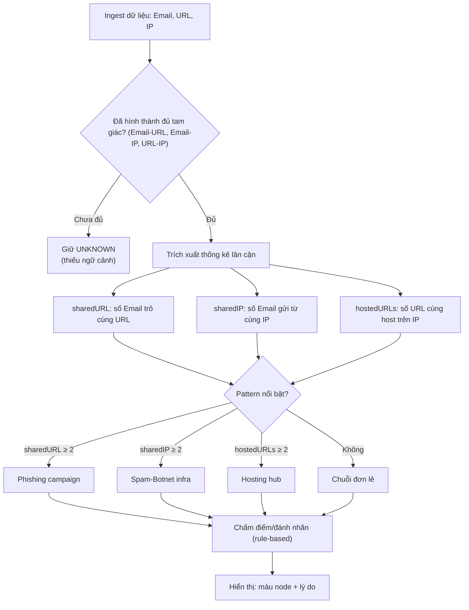

Điểm nhấn: đồ án ưu tiên “giải thích được” hơn là tối ưu mô hình phân loại.

### 6.3 Ưu điểm và hạn chế

**Ưu điểm**
- Truy vấn theo pattern ngắn gọn, đúng “ngữ nghĩa liên kết”, dễ trình bày trong báo cáo và thuyết trình.
- Dễ giải thích kết quả: có thể chỉ trực tiếp trên đồ thị các cạnh liên quan (shared URL/IP, triad) dẫn đến verdict.
- UI trực quan hoá giúp quan sát cụm nghi vấn nhanh hơn so với danh sách dạng bảng thuần.

**Hạn chế (trong phạm vi demo)**
- Thuật toán rule-based tối giản: chủ yếu minh hoạ shared + triad, chưa phản ánh đầy đủ các kỹ thuật chống phishing thực tế.
- Dữ liệu demo nhỏ và “sạch”: chưa mô phỏng nhiễu thực tế (redirect, shortener, CDN, NAT, spoofed headers).
- Chưa có cơ chế xác thực/ủy quyền và kiểm soát truy cập API ở mức production; do đó kết quả chỉ phù hợp cho môi trường demo.

### 6.4 Đánh giá theo các tiêu chí của đồ án

1) **Tính phù hợp mô hình**
- Mô hình Email–URL–IP đủ nhỏ để demo nhưng vẫn thể hiện rõ giá trị của quan hệ.

Phân tích thêm: mô hình 3 thực thể + 3 relationship giúp bài toán có “xương sống” để mô tả multi-hop, shared pattern và triad-gating. Đồng thời, mô hình này dễ mở rộng thêm label/relationship mới trong tương lai mà không phá vỡ kiến trúc.

2) **Khả năng giải thích**
- Dựa vào shared URL/shared IP và triad, hệ thống có thể giải thích trực quan “vì sao đáng nghi”.

Phân tích thêm: khả năng giải thích đến từ việc (i) kết quả `riskScore/verdict` được lưu trên node và (ii) UI/report hiển thị các lý do theo cấu trúc quan hệ. Điều này phù hợp với mục tiêu môn học DACS: ưu tiên sự rõ ràng và kiểm chứng được.

3) **Khả năng mở rộng**
- Có thể mở rộng thêm node/relationship (Domain, ASN, Recipient, Device…) mà không cần thiết kế lại toàn bộ schema như RDBMS.

Phân tích thêm: với Graph DB, mở rộng thường là “thêm nhãn + thêm cạnh + thêm truy vấn pattern” thay vì phải thiết kế lại nhiều bảng trung gian. Tuy nhiên, để mở rộng an toàn cần bổ sung constraint/index và thiết kế quy tắc ingest để tránh dữ liệu bùng nổ.

4) **Khía cạnh an toàn/cấu hình**
- Thông tin kết nối Neo4j được cấu hình qua biến môi trường, giảm nguy cơ lộ mật khẩu.
- API ingest sử dụng `MERGE` để giảm trùng dữ liệu và tránh “bùng nổ” node do nhập lặp.

Phân tích thêm: cách cấu hình qua biến môi trường giúp tách bí mật khỏi source code; `MERGE` + quy ước định danh giúp giảm trùng lặp trong môi trường demo. Ở mức production, vẫn cần thêm cơ chế kiểm soát truy cập và giới hạn tốc độ (rate limiting) để bảo vệ Neo4j khỏi bị spam request.

### 6.5 Phương pháp đánh giá thực nghiệm (đề xuất trình bày trong báo cáo)

Vì đồ án mang tính minh họa, phần đánh giá tập trung vào:

1) **Độ đúng mô hình và truy vấn**
- Kiểm tra triad và shared pattern có xuất hiện đúng theo dữ liệu ingest.

2) **Độ “giải thích được” (explainability)**
- Với mỗi verdict đáng nghi, có thể giải thích bằng liên kết nào dẫn đến điểm số.

3) **Độ ổn định khi tăng dữ liệu (mang tính quan sát)**
- Tăng số Email trỏ cùng URL/IP và quan sát thay đổi score/verdict.

Thay vì đưa bảng thống kê chi tiết theo từng lần ingest, có thể trình bày phần thực nghiệm theo dạng **kịch bản + nhận xét** (phù hợp với đồ án minh hoạ), ví dụ:

- Kịch bản 1: ingest đủ triad (Email–URL–IP) → chạy analyze → quan sát verdict/score.
- Kịch bản 2: tăng dần số Email cùng trỏ một URL (shared URL) → quan sát thay đổi `riskScore/verdict`.
- Kịch bản 3: tăng dần số Email cùng gửi từ một IP (shared IP) → quan sát thay đổi `riskScore/verdict`.

Nếu cần có một chỉ số định lượng tối thiểu, có thể bổ sung **thời gian phản hồi** của 2 endpoint chính (`/api/graph/full`, `/api/graph/analyze`) và ghi trực tiếp vào đoạn mô tả (không cần bảng). Cách đo đơn giản (minh hoạ):

```bash
# đo tổng thời gian cho 1 request
curl -s -o /dev/null -w '%{time_total}\n' http://localhost:8080/api/graph/full
curl -s -o /dev/null -w '%{time_total}\n' http://localhost:8080/api/graph/analyze
```

Để có số liệu ổn định hơn, có thể lặp N lần và lấy trung bình (ví dụ 10–20 lần), đồng thời đảm bảo dữ liệu đồ thị không thay đổi giữa các lần đo.

### 6.6 Chất lượng dữ liệu và rủi ro hiểu sai

Trong thực tế, dữ liệu phishing có thể nhiễu:
- URL rút gọn (shortener), redirect chain.
- IP thay đổi do CDN hoặc NAT.
- Email giả mạo header.

Trong demo, nhóm chủ động “đơn giản hóa” dữ liệu để nhấn mạnh cấu trúc quan hệ. Khi trình bày, cần nêu rõ đây là giới hạn có chủ đích.

Khuyến nghị khi diễn giải kết quả:
- `UNKNOWN` không đồng nghĩa “an toàn”, mà là **thiếu ngữ cảnh** để kết luận (triad-gating).
- Shared pattern chỉ là tín hiệu cấu trúc; trong thực tế cần kết hợp thêm thuộc tính (timestamp, domain reputation, SPF/DKIM/DMARC, ASN, geolocation, blacklist, v.v.).
- Nên chuẩn hoá input (lowercase email, chuẩn hoá URL, validate IP) để tránh “một thực thể thành nhiều node” do sai định dạng.

### 6.7 Góc nhìn an toàn (liên hệ môn học DACS)

Mặc dù hệ thống là demo, vẫn có các điểm cần chú ý về an toàn dữ liệu và cấu hình:

1) **Quản lý bí mật (secrets)**
- Không hard-code mật khẩu DB.
- Dùng biến môi trường và tránh ghi log lộ credentials.

2) **Validation input**
- Email/URL/IP nên được validate ở mức cơ bản để tránh dữ liệu “bẩn” và giảm nguy cơ injection.
- Trong đồ án, ingest dùng query parameter và bind parameter trong `Neo4jClient` giúp giảm rủi ro Cypher injection.

Gợi ý bổ sung (định hướng): giới hạn độ dài input, chặn ký tự bất thường, và chuẩn hoá định dạng trước khi tạo `id` để tránh phân mảnh dữ liệu.

3) **Kiểm soát truy cập API (định hướng)**
- Trong bản demo, các endpoint chủ yếu phục vụ minh hoạ và chưa đặt nặng cơ chế xác thực/ủy quyền.
- Khi triển khai thực tế, cần bổ sung authentication (API key/JWT), phân quyền (ai được ingest/analyze/xoá), và rate limiting để tránh lạm dụng.

3) **Nguyên tắc kết luận thận trọng**
- Triad-gating là một cơ chế giảm rủi ro “kết luận sai” khi thiếu ngữ cảnh.
- Trong báo cáo cần nhấn mạnh: UNKNOWN không đồng nghĩa an toàn, mà là chưa đủ bằng chứng.

---

## CHƯƠNG 7: THỰC NGHIỆM HỆ THỐNG

### 7.1 Mục tiêu và phạm vi thực nghiệm

Trong đồ án này, “thực nghiệm hệ thống” được hiểu theo nghĩa **thực nghiệm demo/kiểm chứng** (proof-of-concept), tập trung xác nhận:

1) **Tính đúng (correctness) của mô hình đồ thị**
- Node/relationship được tạo đúng theo dữ liệu nhập.
- Các pattern chính (triad, shared URL, shared IP) xuất hiện đúng trong Neo4j.

2) **Tính đúng của cơ chế kết luận (triad-gating + rule-based scoring)**
- Nếu thiếu tam giác Email–URL–IP thì kết quả tổng quan phải là `verdict=UNKNOWN` và `score=0`.
- Nếu đủ triad, điểm số phản ánh các indicator đã thiết kế.

3) **Khả năng giải thích (explainability) và trình bày**
- Có thể giải thích vì sao một Email/URL/IP bị đánh dấu đáng nghi dựa vào “dùng chung hạ tầng” và cấu trúc liên kết.

Phạm vi và giả định:
- Dữ liệu demo do nhóm tự tạo, mang tính minh họa (không đại diện tập dữ liệu thực tế).
- Mục tiêu không phải benchmark hiệu năng tuyệt đối, mà là quan sát phản hồi API và độ ổn định khi tăng dữ liệu.

### 7.2 Thước đo/tiêu chí ghi nhận (gợi ý trình bày trong Word)

Nhóm có thể ghi nhận các tiêu chí sau (định tính + định lượng):

- **Số lượng node/relationship** sau mỗi lần ingest (đối chiếu `/api/graph/full` và Neo4j Browser).
- **Thời gian phản hồi** (ms) của các API chính (`/api/graph/full`, `/api/graph/analyze`).
- **Tỷ lệ UNKNOWN** trong tập Email demo (để minh họa triad-gating).
- **Minh chứng trực quan**: screenshot UI trước/sau analyze; screenshot Neo4j Browser truy vấn triad/shared.

> Gợi ý: đo thời gian phản hồi bằng `curl -w "%{time_total}"` hoặc dùng DevTools Network khi mở UI.

### 7.3 Chuẩn bị môi trường

1) Cấu hình biến môi trường Neo4j (tham khảo Chương 5).
2) Chạy ứng dụng Spring Boot.
3) Xác nhận hệ thống kết nối Neo4j:

```bash
curl http://localhost:8080/api/graph/health
```

Kỳ vọng:
- HTTP 200
- JSON có trường `status` thể hiện kết nối Neo4j thành công.

### 7.4 Tạo dữ liệu demo

Mục tiêu của bước này là tạo các cấu trúc đặc trưng:
- 01 triad tối thiểu (Email–URL–IP)
- 01 chiến dịch shared URL (nhiều Email → 01 URL)
- 01 hạ tầng shared IP (nhiều Email → 01 IP)
- 01 tình huống thiếu triad (để minh họa UNKNOWN)

> **Hình 7.2 (minh họa)**: Dữ liệu demo sau ingest (KS1–KS4), trước khi analyze. Nhóm có thể thay ảnh minh họa bằng screenshot UI thật khi hoàn thiện báo cáo.


#### 7.4.1 Kịch bản 1: Tạo một triad tối thiểu

```bash
BASE="http://localhost:8080"
API="$BASE/api/graph"

curl -G "$API/link" \
  --data-urlencode "email=triad1@demo.local" \
  --data-urlencode "url=http://min.example/one" \
  --data-urlencode "ip=10.0.0.10"
```

Kỳ vọng:
- Tạo đủ 3 node và 3 relationship, hình thành tam giác Email–URL–IP.

Đối chiếu bằng Cypher (minh họa):

```cypher
MATCH (e:Email {value:"triad1@demo.local"})-[r1:CONTAINS_LINK]->(u:URL)
MATCH (e)-[r2:SENT_FROM]->(i:IPAddress)
MATCH (u)-[r3:HOSTED_BY]->(i)
RETURN e,u,i,r1,r2,r3;
```

#### 7.4.2 Kịch bản 2: Tạo shared URL (campaign)

Tạo shared URL:

```bash
BASE="http://localhost:8080"
API="$BASE/api/graph"

curl -G "$API/link" \
  --data-urlencode "email=camp1@demo.local" \
  --data-urlencode "url=http://campaign.example/login" \
  --data-urlencode "ip=10.0.0.21"
curl -G "$API/link" \
  --data-urlencode "email=camp2@demo.local" \
  --data-urlencode "url=http://campaign.example/login" \
  --data-urlencode "ip=10.0.0.22"
curl -G "$API/link" \
  --data-urlencode "email=camp3@demo.local" \
  --data-urlencode "url=http://campaign.example/login" \
  --data-urlencode "ip=10.0.0.23"
```

Kỳ vọng:
- URL `http://campaign.example/login` được nhiều Email trỏ tới.
- Sau khi analyze, URL/Email có thể tăng điểm theo rule shared URL.

Gợi ý tạo thêm 1–2 Email nữa để thấy rõ hiệu ứng (tùy thời gian demo).

#### 7.4.3 Kịch bản 3: Tạo shared IP (hạ tầng gửi)

```bash
BASE="http://localhost:8080"
API="$BASE/api/graph"

curl -G "$API/link" \
  --data-urlencode "email=infra1@demo.local" \
  --data-urlencode "url=http://infra.example/a" \
  --data-urlencode "ip=10.0.0.30"
curl -G "$API/link" \
  --data-urlencode "email=infra2@demo.local" \
  --data-urlencode "url=http://infra.example/b" \
  --data-urlencode "ip=10.0.0.30"
curl -G "$API/link" \
  --data-urlencode "email=infra3@demo.local" \
  --data-urlencode "url=http://infra.example/c" \
  --data-urlencode "ip=10.0.0.30"
```

Kỳ vọng:
- IP `10.0.0.30` được nhiều Email `SENT_FROM`.

Đối chiếu nhanh bằng Cypher:

```cypher
MATCH (i:IPAddress {value:"10.0.0.30"})<-[:SENT_FROM]-(e:Email)
RETURN i.value, collect(e.value) AS emails, count(DISTINCT e) AS n;
```

#### 7.4.4 Kịch bản 4: Nhập dữ liệu thiếu triad (để thấy UNKNOWN)

Chỉ tạo node/quan hệ từng phần:

```bash
BASE="http://localhost:8080"
API="$BASE/api/graph"

curl -G "$API/link-partial" \
  --data-urlencode "email=orphan1@demo.local" \
  --data-urlencode "url=http://orphan.example/only"
```

Kỳ vọng:
- Chưa đủ tam giác Email–URL–IP nên khi chạy `/api/graph/analyze`, Email này giữ `verdict=UNKNOWN`.

Giải thích:
- Đây là chủ đích thiết kế để tránh “kết luận khi thiếu ngữ cảnh”.
- Trên UI, node thiếu triad vẫn tồn tại trong graph nhưng không bị gán nhãn đáng nghi.

### 7.5 Chạy phân tích

```bash
curl http://localhost:8080/api/graph/analyze
```

Kỳ vọng đọc kết quả:
- Mỗi phần tử trả về gồm `email` (id), `score`, `verdict`, `hasTriad`.
- Nếu `hasTriad=false` thì `verdict` là `UNKNOWN` và `score=0`.

Ví dụ kết quả (minh họa):

```json
[
  {"email":"Email:triad1@demo.local","score":60,"verdict":"FRAUD","hasTriad":true},
  {"email":"Email:orphan1@demo.local","score":0,"verdict":"UNKNOWN","hasTriad":false}
]
```

Ngoài ra, có thể xem phân tích chi tiết:

```bash
curl http://localhost:8080/api/graph/analysis/email-risk
curl http://localhost:8080/api/graph/analysis/url-risk
curl http://localhost:8080/api/graph/analysis/ip-risk
```

### 7.6 Demo giao diện và report

#### 7.6.1 Kết quả trực quan hóa

- Mở `http://localhost:8080/` xem graph.
- Mở `http://localhost:8080/report.html` xem report.

Kịch bản quan sát trên UI (gợi ý trình bày):
1) Trước analyze: graph có node/edge nhưng chưa có `riskScore/verdict`.
2) Chạy analyze: reload UI hoặc bấm refresh (tùy UI) để xem node được tô/nhóm theo verdict.
3) Click node: xem panel chi tiết (id/type/score/verdict + các indicator nếu có).

> **Hình 7.4 (minh họa)**: Minh họa cụm shared URL/shared IP sau analyze (phục vụ chèn hình vào Word). Nếu nhóm có screenshot UI thật, có thể thay ảnh minh họa này bằng screenshot.


Nếu cần đối chiếu dữ liệu thô mà UI đang dùng:

```bash
curl http://localhost:8080/api/graph/full
```

#### 7.6.2 Demo giao diện (UI walkthrough – 2 đến 3 phút)

Mục tiêu của phần này là trình bày rõ **người dùng thao tác gì trên giao diện** và **vì sao giao diện chứng minh được giá trị của Graph DB**.

**Bước 1: Mở giao diện đồ thị**
- Mở trang chính: `http://localhost:8080/`.
- Kỳ vọng: thấy các node/edge theo dữ liệu đã ingest.

> Gợi ý chụp ảnh: tổng quan đồ thị trước analyze (Hình 7.1).

**Bước 2: Chạy analyze và quan sát node đổi màu/nhóm theo verdict**
- Gọi API: `GET /api/graph/analyze` (terminal/Postman) rồi reload trang.
- Kỳ vọng: các node đủ triad được gán `riskScore` và `verdict` (SAFE/SUSPICIOUS/FRAUD); node thiếu triad giữ `UNKNOWN`.

**Bước 3: Dùng filter để “khoanh vùng” các cụm đáng nghi**
- Trên UI, bật/tắt filter theo loại node (Email/URL/IP) và theo verdict.
- Mục tiêu thuyết trình: chỉ ra nhanh cụm **shared URL** (nhiều Email → 1 URL) và cụm **shared IP** (nhiều Email → 1 IP).

Mô tả rõ cơ chế “tắt node / tắt mối quan hệ” (đúng theo hành vi lọc phổ biến của UI đồ thị):
- Khi **tắt một nhóm node** (ví dụ tắt `IPAddress`, hoặc tắt verdict `SAFE`), UI sẽ **ẩn các node đó** khỏi màn hình.
- Đồng thời, các **relationship (edge) có một đầu mút bị ẩn** cũng sẽ **tự động bị ẩn theo**. Cách làm này giúp không còn “cạnh treo” và đồ thị sau lọc vẫn nhất quán về mặt cấu trúc.
- Nhờ đó, người thuyết trình có thể “giảm nhiễu” bằng cách tắt bớt node/edge không liên quan, tập trung vào các pattern cần minh họa.

Ví dụ thao tác để demo nhanh (2–3 câu nói trên slide):
- **Cô lập shared URL**: bật `Email` + `URL`, tắt `IPAddress` → đồ thị chỉ còn quan hệ Email–URL, dễ nhìn cụm “nhiều Email cùng trỏ 1 URL”.
- **Cô lập shared IP**: bật `Email` + `IPAddress`, tắt `URL` → đồ thị chỉ còn quan hệ Email–IP, dễ nhìn cụm “nhiều Email cùng gửi từ 1 IP”.
- **Chỉ xem node đáng nghi**: tắt `SAFE`, chỉ bật `SUSPICIOUS/FRAUD` (và có thể giữ `UNKNOWN` tuỳ mục tiêu trình bày) để khoanh vùng cụm rủi ro.

Ghi chú: nếu nhóm muốn “tắt theo *loại relationship*” (CONTAINS_LINK / SENT_FROM / HOSTED_BY) như một chức năng riêng, có thể bổ sung thêm checkbox theo edge-type ở UI; tuy nhiên trong bản demo hiện tại có thể đạt hiệu ứng tương tự bằng cách tắt/bật **loại node** như các ví dụ trên.

> Gợi ý chụp ảnh: giao diện đang lọc + nhìn rõ một cụm pattern (Hình 7.6).

**Bước 4: Click node để xem chi tiết/giải thích**
- Click vào node URL trong kịch bản shared URL.
- Click vào node IP trong kịch bản shared IP.
- Kỳ vọng: panel hiển thị `id`, `type`, `riskScore`, `verdict` và quan hệ liên quan (để giải thích “vì sao đáng nghi”).

**Bước 5: Mở trang report**
- Mở: `http://localhost:8080/report.html`.
- Kỳ vọng: report tổng hợp giúp thuyết trình nhanh (có thể dùng khi chụp màn hình/bổ sung minh chứng).

> Gợi ý chụp ảnh: trang report (Hình 7.3).

#### 7.6.3 Thử lưu layout

Sau khi kéo thả node trên UI, gọi API lưu layout (minh họa):

```bash
curl -X POST http://localhost:8080/api/graph/layout/save \
  -H 'Content-Type: application/json' \
  -d '[{"id":"Email:triad1@demo.local","x":120.5,"y":340.2}]'
```

Kỳ vọng:
- Nếu `id` tồn tại trên graph và tọa độ hợp lệ: response dạng `{"status":"ok","saved":1}` (hoặc `saved` lớn hơn nếu gửi nhiều node).
- Nếu body rỗng: `{"status":"no_input","saved":0,...}`.
- Nếu body có nhưng thiếu `id/x/y` hợp lệ: `{"status":"no_valid_rows","saved":0,...}`.

Gợi ý nhanh để lấy đúng `id` (để test chắc chắn): gọi `/api/graph/full`, lấy một `nodes[i].id` rồi dùng lại cho payload lưu layout.

Ghi chú:
- Mục đích của lưu layout là giúp demo ổn định (node không bị “nhảy” vị trí giữa các lần mở).
- Layout chỉ là thuộc tính hiển thị, không ảnh hưởng logic chấm điểm.

#### 7.6.4 Checklist ảnh UI cần chụp

- **Hình 7.1**: UI graph ngay sau ingest (chưa analyze hoặc trước khi refresh/analyze).
- **Hình 7.3**: Trang `report.html` (có bảng/summary).
- **Hình 7.6**: UI đang bật filter (tắt một nhóm node để edge tự ẩn) và nhìn rõ một cụm pattern; có thể mở panel 1 node (URL hoặc IP) nếu muốn minh họa chi tiết.
- **Hình 7.7**: Kéo thả node → bấm lưu layout (hoặc gọi API lưu) → reload trang và bố cục được giữ.

### 7.7 Đánh giá kết quả

Phần này nhằm xác minh 3 điểm chính của hệ thống demo: (i) dữ liệu ingest đúng mô hình, (ii) triad-gating hoạt động đúng, và (iii) rule shared URL/shared IP tạo ra thay đổi quan sát được trên UI/report.

Đánh giá theo từng tiêu chí:

1) **Đúng mô hình dữ liệu**
- `MERGE` đảm bảo không tạo trùng node khi ingest lặp.
- Relationship đúng hướng và đúng type.

Cách kiểm tra nhanh:
- Trên Neo4j Browser, chạy `MATCH (n) RETURN count(n)` trước và sau khi gọi ingest lặp để đảm bảo số node không tăng bất thường.
- Dùng `MATCH` theo từng relationship type để xác nhận hướng cạnh (Email→URL, Email→IP, URL→IP).

2) **Đúng triad-gating**
- Email thiếu một trong hai cạnh `CONTAINS_LINK` hoặc `SENT_FROM` hoặc thiếu cạnh `HOSTED_BY` giữa URL–IP → `hasTriad=false`.

Cách quan sát:
- Sau khi chạy `/api/graph/analyze`, đối chiếu các Email nhập thiếu trường (KS4) phải có `hasTriad=false` và `verdict=UNKNOWN`.
- Trên UI, các node thiếu triad thường giữ màu/nhãn `UNKNOWN` để thể hiện “thiếu ngữ cảnh”, không phải “an toàn”.

3) **Đúng rule shared**
- Khi nhiều Email cùng trỏ một URL hoặc cùng gửi từ một IP, điểm của các thực thể liên quan tăng theo rule.

Cách kiểm tra nhanh:
- Tạo 2–3 Email trỏ cùng một URL (KS2) rồi chạy analyze, quan sát cụm Email–URL xuất hiện rõ hơn khi bật filter.
- Tạo 2–3 Email gửi từ cùng một IP (KS3) rồi chạy analyze, quan sát cụm Email–IP.

4) **Tính giải thích được**
- Có thể truy ngược bằng Cypher: “Email này liên quan URL nào, IP nào, và dùng chung với bao nhiêu Email khác”.

Gợi ý Cypher ngắn (minh hoạ):

```cypher
MATCH (e:Email {value:"camp1@demo.local"})-[:CONTAINS_LINK]->(u:URL)
OPTIONAL MATCH (u)<-[:CONTAINS_LINK]-(e2:Email)
RETURN e.value AS email, u.value AS url, count(DISTINCT e2) AS sharedByEmails;
```

Gợi ý cách thuyết trình dựa trên thực nghiệm:
- Cho xem một Email đủ triad và một Email thiếu triad để giải thích triad-gating.
- Tạo 2–3 Email cùng URL để minh họa shared URL (campaign) và thấy điểm tăng.
- Tạo 2–3 Email cùng IP để minh họa shared IP (hạ tầng gửi).

### 7.9 Quy trình ghi nhận và tái lập (reproducibility)

Để báo cáo có tính “tái lập”, nhóm có thể dùng quy trình sau:

1) Reset dữ liệu demo (xem Chương 5).
2) Chạy lần lượt KS1 → KS4.
3) Ghi lại cấu hình môi trường: phiên bản Java (`java -version`) và cấu hình kết nối Neo4j (chỉ ghi `NEO4J_URI`, không ghi mật khẩu vào báo cáo).
4) Gọi `/api/graph/full` lưu JSON (làm phụ lục nếu cần) để chứng minh cấu trúc node/link.
5) Chạy `/api/graph/analyze` và lưu JSON kết quả để đối chiếu triad-gating + verdict.
6) Chụp screenshot UI và Neo4j Browser theo danh mục hình (Hình 7.1/7.3/7.5/7.6/7.7).

### 7.10 Lỗi thường gặp khi chạy demo (và cách xử lý)

1) **Kết nối Neo4j thất bại**
- Dấu hiệu: `/api/graph/health` trả lỗi hoặc status không connected.
- Cách xử lý: kiểm tra `NEO4J_URI/USERNAME/PASSWORD/DATABASE`, kiểm tra Neo4j đang chạy.

Gợi ý khoanh vùng:
- Nếu backend không chạy: kiểm tra `server.port` và log “Started ...”.
- Nếu backend chạy nhưng Neo4j lỗi: kiểm tra firewall/whitelist (nếu dùng Aura) và đúng scheme (`neo4j://` hoặc `neo4j+s://`).

2) **Gradle/Maven lỗi phiên bản Java**
- Dấu hiệu: build fail yêu cầu Java 17.
- Cách xử lý: đặt `JAVA_HOME` trỏ về JDK 17 trước khi chạy.

3) **Graph không hiện đủ dữ liệu trên UI**
- Dấu hiệu: UI trống hoặc thiếu node.
- Cách xử lý: gọi `/api/graph/full` để xác nhận backend có dữ liệu; nếu có thì kiểm tra console log của browser.

Gợi ý:
- Nếu `/api/graph/full` trả về `nodes=[]`, có thể bạn chưa ingest dữ liệu.
- Nếu `/api/graph/full` có dữ liệu nhưng UI không vẽ, kiểm tra lỗi JS/CORS trong DevTools.

4) **Email/URL/IP không được kết luận (UNKNOWN) dù mong đợi**
- Dấu hiệu: `hasTriad=false`.
- Cách xử lý: kiểm tra đã tạo đủ 3 cạnh để thành triad (Email–URL, Email–IP, URL–IP).

Gợi ý:
- Nếu bạn ingest bằng `link-partial`, cần gọi bổ sung phần còn thiếu để khép triad, sau đó chạy lại analyze.

---

## KẾT LUẬN

### Những kết quả đạt được
- Tìm hiểu lý thuyết Graph DB và Neo4j/Cypher.
- Xây dựng mô hình Email–URL–IP và ingest dữ liệu bằng `MERGE`.
- Minh họa phân tích rủi ro theo luật (rule-based) có cơ chế triad-gating (`UNKNOWN` khi thiếu ngữ cảnh) và trực quan hóa bằng D3.
- Hoàn thiện các thao tác demo trên UI: lọc theo loại node/verdict để khoanh vùng pattern và lưu layout để ổn định bố cục khi trình bày.

### Ý nghĩa của Graph Database trong bài toán
- Phù hợp cho truy vấn theo pattern và truy vết multi-hop.

Trong bối cảnh bài toán minh hoạ phishing/fraud, giá trị chính đến từ khả năng biểu diễn và truy vấn trực tiếp các cấu trúc như shared URL/shared IP/triad, giúp kết quả có thể giải thích bằng liên kết trên đồ thị (thay vì chỉ là một nhãn dự đoán).

### Hướng phát triển
- Bổ sung node/relationship (Domain, ASN, User/Recipient...).
- Bổ sung thuật toán cộng đồng (community detection), centrality.
- Hoàn thiện validation dữ liệu đầu vào, kiểm thử API và bổ sung cơ chế kiểm soát truy cập (authentication/authorization) nếu triển khai ngoài phạm vi demo.

---

## TÀI LIỆU THAM KHẢO


[1] Neo4j Documentation, “Neo4j Cypher Manual,” truy cập 2026. [Online]. Available: https://neo4j.com/docs/

[2] Neo4j Documentation, “Cypher Query Language,” truy cập 2026. [Online]. Available: https://neo4j.com/docs/cypher-manual/

[3] Spring Documentation, “Spring Boot Reference,” truy cập 2026. [Online]. Available: https://docs.spring.io/spring-boot/

[4] Spring Data Neo4j Documentation, “Reference Documentation,” truy cập 2026. [Online]. Available: https://docs.spring.io/spring-data/neo4j/docs/

[5] M. Newman, *Networks: An Introduction*. Oxford University Press, 2010.

[6] D3.js, “D3: Data-Driven Documents,” truy cập 2026. [Online]. Available: https://d3js.org/

[7] I. Robinson, J. Webber, and E. Eifrem, *Graph Databases: New Opportunities for Connected Data*, 2nd ed. O’Reilly Media, 2015.

[8] Subin1707, “DACSCNTT,” GitHub repository. [Online]. Available: https://github.com/Subin1707/DACSCNTT. [Accessed: 03-Mar-2026].

[9] Neo4j Documentation, “Neo4j Graph Data Science Manual,” truy cập 2026. [Online]. Available: https://neo4j.com/docs/graph-data-science/

[10] OWASP Foundation, “OWASP API Security Top 10,” truy cập 2026. [Online]. Available: https://owasp.org/www-project-api-security/

[11] OWASP Foundation, “OWASP Top 10,” truy cập 2026. [Online]. Available: https://owasp.org/www-project-top-ten/

[12] W. L. Hamilton, *Graph Representation Learning*. Morgan & Claypool Publishers, 2020.

---

## PHỤ LỤC

### Phụ lục A: Danh sách API chính (tóm tắt)

- `GET /api/graph/health`
- `GET /api/graph/link`
- `POST /api/graph/link`
- `GET /api/graph/link-partial`
- `GET /api/graph/analyze`
- `GET /api/graph/analysis/email-risk`
- `GET /api/graph/analysis/url-risk`
- `GET /api/graph/analysis/ip-risk`
- `GET /api/graph/full`
- `POST /api/graph/layout/save`
- `DELETE /api/graph/node?id=...`

Ghi chú:
- `/api/graph/analyze`: cập nhật `riskScore` + `verdict` (SAFE/SUSPICIOUS/FRAUD/UNKNOWN) trực tiếp lên node (phục vụ UI).
- `/api/graph/analysis/*`: trả về thống kê + indicators (phục vụ phân tích chi tiết/báo cáo).

### Phụ lục B: Một số truy vấn Cypher minh họa

**Shared URL**
```cypher
MATCH (u:URL)<-[:CONTAINS_LINK]-(e:Email)
RETURN u.value, count(DISTINCT e) AS emailCount
ORDER BY emailCount DESC;
```

**Shared IP**
```cypher
MATCH (i:IPAddress)<-[:SENT_FROM]-(e:Email)
RETURN i.value, count(DISTINCT e) AS emailCount
ORDER BY emailCount DESC;
```

**Trace Email → URL → IP**
```cypher
MATCH (e:Email)-[:CONTAINS_LINK]->(u:URL)-[:HOSTED_BY]->(i:IPAddress)
RETURN e.value, u.value, i.value;
```

### Phụ lục C: Seed dữ liệu demo (curl) cho KS1–KS4

Mục tiêu: tạo dữ liệu để demo/chụp ảnh theo đúng các kịch bản trong Chương 7:
- **KS1**: 01 triad tối thiểu (Email–URL–IP)
- **KS2**: 01 chiến dịch shared URL (nhiều Email → 01 URL)
- **KS3**: 01 hạ tầng shared IP (nhiều Email → 01 IP)
- **KS4**: 01 tình huống thiếu triad (để minh họa `UNKNOWN`)

> Ghi chú: dùng `--data-urlencode` để tránh lỗi ký tự đặc biệt trong URL.
> Các lệnh seed bên dưới đang dùng `curl -G` nên sẽ gọi **GET** `/api/graph/link` (tiện cho demo nhanh bằng query string).

**A) Seed dữ liệu**

```bash
BASE="http://localhost:8080"
API="$BASE/api/graph"

# KS1: 01 triad tối thiểu
curl -G "$API/link" \
  --data-urlencode "email=triad1@demo.local" \
  --data-urlencode "url=http://min.example/one" \
  --data-urlencode "ip=10.0.0.10"

# KS2: shared URL (3 Email -> 1 URL)
curl -G "$API/link" \
  --data-urlencode "email=camp1@demo.local" \
  --data-urlencode "url=http://campaign.example/login" \
  --data-urlencode "ip=10.0.0.21"
curl -G "$API/link" \
  --data-urlencode "email=camp2@demo.local" \
  --data-urlencode "url=http://campaign.example/login" \
  --data-urlencode "ip=10.0.0.22"
curl -G "$API/link" \
  --data-urlencode "email=camp3@demo.local" \
  --data-urlencode "url=http://campaign.example/login" \
  --data-urlencode "ip=10.0.0.23"

# KS3: shared IP (3 Email -> 1 IP)
curl -G "$API/link" \
  --data-urlencode "email=infra1@demo.local" \
  --data-urlencode "url=http://infra.example/a" \
  --data-urlencode "ip=10.0.0.30"
curl -G "$API/link" \
  --data-urlencode "email=infra2@demo.local" \
  --data-urlencode "url=http://infra.example/b" \
  --data-urlencode "ip=10.0.0.30"
curl -G "$API/link" \
  --data-urlencode "email=infra3@demo.local" \
  --data-urlencode "url=http://infra.example/c" \
  --data-urlencode "ip=10.0.0.30"

# KS4: thiếu triad (Email + URL, không có IP)
curl -G "$API/link-partial" \
  --data-urlencode "email=orphan1@demo.local" \
  --data-urlencode "url=http://orphan.example/only"

# Chạy analyze để cập nhật riskScore + verdict cho UI
curl "$API/analyze"
```

**B) Dọn dữ liệu để seed lại (không cần truy cập Neo4j Browser)**

Trong hệ thống có endpoint xóa theo `id`:

```bash
BASE="http://localhost:8080"
API="$BASE/api/graph"

curl -X DELETE -G "$API/node" --data-urlencode "id=Email:triad1@demo.local"
curl -X DELETE -G "$API/node" --data-urlencode "id=URL:http://min.example/one"
curl -X DELETE -G "$API/node" --data-urlencode "id=IPAddress:10.0.0.10"

curl -X DELETE -G "$API/node" --data-urlencode "id=Email:camp1@demo.local"
curl -X DELETE -G "$API/node" --data-urlencode "id=Email:camp2@demo.local"
curl -X DELETE -G "$API/node" --data-urlencode "id=Email:camp3@demo.local"
curl -X DELETE -G "$API/node" --data-urlencode "id=URL:http://campaign.example/login"
curl -X DELETE -G "$API/node" --data-urlencode "id=IPAddress:10.0.0.21"
curl -X DELETE -G "$API/node" --data-urlencode "id=IPAddress:10.0.0.22"
curl -X DELETE -G "$API/node" --data-urlencode "id=IPAddress:10.0.0.23"

curl -X DELETE -G "$API/node" --data-urlencode "id=Email:infra1@demo.local"
curl -X DELETE -G "$API/node" --data-urlencode "id=Email:infra2@demo.local"
curl -X DELETE -G "$API/node" --data-urlencode "id=Email:infra3@demo.local"
curl -X DELETE -G "$API/node" --data-urlencode "id=URL:http://infra.example/a"
curl -X DELETE -G "$API/node" --data-urlencode "id=URL:http://infra.example/b"
curl -X DELETE -G "$API/node" --data-urlencode "id=URL:http://infra.example/c"
curl -X DELETE -G "$API/node" --data-urlencode "id=IPAddress:10.0.0.30"

curl -X DELETE -G "$API/node" --data-urlencode "id=Email:orphan1@demo.local"
curl -X DELETE -G "$API/node" --data-urlencode "id=URL:http://orphan.example/only"
```
