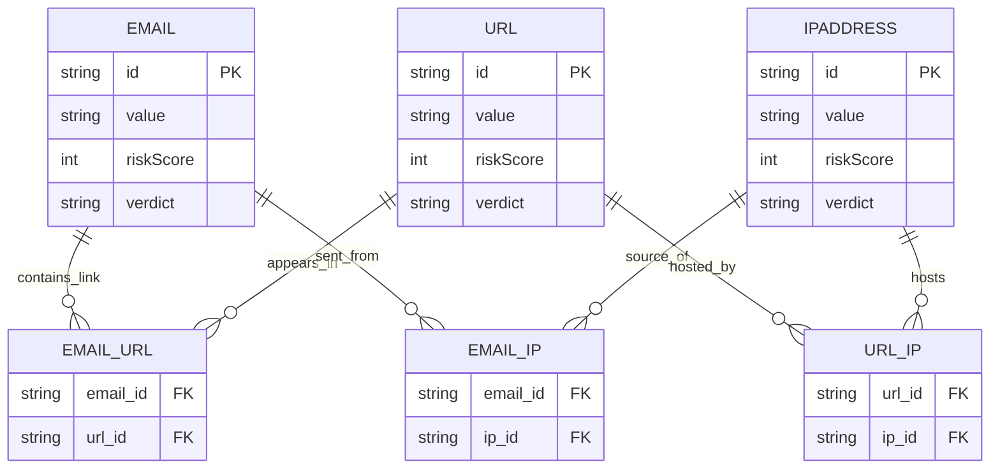

# Phân tích và tìm hiểu về Graph Database

Tài liệu này tổng hợp phần lý thuyết phục vụ mục tiêu đồ án: **tìm hiểu CSDL đồ thị**, làm nền cho việc **xây dựng mô hình dữ liệu** và **phân tích rút ra từ đồ thị** trong bài toán minh họa (phát hiện gian lận/phishing).

---

## 1. Lý thuyết đồ thị (Graph Theory)

### 1.1. Khái niệm đồ thị

Trong toán học và khoa học máy tính, **đồ thị (Graph)** là cấu trúc dữ liệu mô tả các đối tượng và mối quan hệ giữa chúng. Đồ thị xuất hiện nhiều trong: mạng máy tính, mạng xã hội, tìm đường đi, AI và cơ sở dữ liệu.

Về mặt hình thức:

$$G = (V, E)$$

Trong đó:
- $V$ (Vertices/Nodes): tập các đỉnh, đại diện cho thực thể/đối tượng.
- $E$ (Edges): tập các cạnh, biểu diễn quan hệ giữa các đỉnh.

### 1.2. Các thành phần cơ bản

#### 1.2.1. Đỉnh (Node/Vertex)

- Đại diện cho một thực thể trong hệ thống (người dùng, tài khoản, URL, sản phẩm, …).
- Là đơn vị cơ bản nhất của đồ thị.

#### 1.2.2. Cạnh (Edge/Relationship)

- Biểu diễn mối quan hệ giữa hai đỉnh.
- Quan hệ có thể mang ý nghĩa logic/vật lý/ngữ nghĩa.

#### 1.2.3. Hướng của cạnh

- **Cạnh có hướng (Directed Edge)**: có chiều từ đỉnh nguồn đến đỉnh đích.
- **Cạnh vô hướng (Undirected Edge)**: không phân biệt chiều.

#### 1.2.4. Trọng số (Weight – nếu có)

- Biểu diễn chi phí/khoảng cách/mức độ liên kết.
- Thường dùng trong các bài toán tối ưu như tìm đường đi ngắn nhất.

### 1.3. Phân loại đồ thị

- **Đồ thị vô hướng**: cạnh không có hướng (ví dụ: quan hệ bạn bè).
- **Đồ thị có hướng**: cạnh có hướng (ví dụ: liên kết giữa các trang web).
- **Đồ thị có trọng số**: mỗi cạnh có trọng số (ví dụ: khoảng cách giữa các thành phố).
- **Đồ thị đơn / đa cạnh**:
	- Đồ thị đơn: không có cạnh trùng.
	- Đồ thị đa cạnh: có thể có nhiều cạnh giữa cùng một cặp đỉnh.

---

## 2. Cơ sở dữ liệu đồ thị (Graph Database)

### 2.1. Khái niệm

**Graph Database** là hệ quản trị cơ sở dữ liệu sử dụng cấu trúc đồ thị để lưu trữ và biểu diễn dữ liệu. Dữ liệu được mô hình hóa qua:

- **Node (nút/đỉnh)**
- **Relationship/Edge (cạnh/quan hệ)**
- **Properties (thuộc tính)**

Khác với CSDL quan hệ, Graph Database lưu mối quan hệ **trực tiếp** giữa các thực thể, giúp truy vấn liên kết nhiều bước trở nên tự nhiên và trực quan.

### 2.2. Các thành phần chính

#### 2.2.1. Node

- Đại diện thực thể trong bài toán.
- Có thể có **nhãn (label/type)**.
- Có thể chứa **properties** (key–value).

#### 2.2.2. Relationship

- Biểu diễn quan hệ giữa các node.
- Thường **có hướng** và có thể có properties.
- Là thành phần cốt lõi trong Graph Database.

#### 2.2.3. Properties

- Cặp khóa–giá trị (key–value).
- Có thể gắn trên node và/hoặc relationship.

### 2.3. Đặc điểm nổi bật

- **Biểu diễn quan hệ trực quan**: quan hệ được lưu dưới dạng cạnh.
- **Hiệu năng tốt với truy vấn nhiều bước**: không cần JOIN phức tạp.
- **Mô hình linh hoạt**: dễ mở rộng khi thêm loại node/quan hệ.
- **Tập trung vào quan hệ**: phù hợp dữ liệu liên kết dày đặc.

### 2.4. So sánh Graph Database và CSDL quan hệ

| Tiêu chí | Graph Database | CSDL quan hệ |
|---|---|---|
| Mô hình dữ liệu | Đồ thị | Bảng |
| Biểu diễn quan hệ | Relationship | Khóa ngoại |
| Truy vấn liên kết nhiều bước | Duyệt trực tiếp theo cạnh | JOIN nhiều bảng |
| Hiệu năng khi truy vấn quan hệ phức tạp | Cao, ổn định | Giảm khi JOIN nhiều |
| Mở rộng mô hình | Linh hoạt | Thường khó thay đổi |
| Bài toán phù hợp | Dữ liệu nhiều liên kết | Dữ liệu chuẩn hóa |

### 2.5. Sơ đồ ER (RDBMS) tương đương và so sánh với Graph

Để so sánh trực quan, có thể biểu diễn cùng một bài toán **Email – URL – IPAddress** theo 2 cách:

**(1) Mô hình CSDL quan hệ (ER/Relational)**

- Thực thể chính: `Email`, `URL`, `IPAddress`.
- Do quan hệ là N–N (một email có thể chứa nhiều URL; một URL có thể xuất hiện trong nhiều email, ...), ta cần các bảng liên kết (join table).

Sơ đồ ER (mang tính minh họa):



**(2) Mô hình Graph (Property Graph như Neo4j)**

- `Email`, `URL`, `IPAddress` là node.
- `CONTAINS_LINK`, `SENT_FROM`, `HOSTED_BY` là relationship.

Sơ đồ Graph (minh họa):

```mermaid
flowchart LR
  E[(:Email {value})]
  U[(:URL {value})]
  I[(:IPAddress {value})]

  E -- CONTAINS_LINK --> U
  E -- SENT_FROM --> I
  U -- HOSTED_BY --> I
```

**Ý nghĩa so sánh**:
- Ở RDBMS, “mối quan hệ” thường được biểu diễn gián tiếp qua **khóa ngoại** + **join table**.
- Ở Graph DB, “mối quan hệ” là một thực thể hạng nhất (first-class) và được duyệt trực tiếp bằng traversal.

### 2.6. So sánh performance (lý thuyết): JOIN vs Graph Traversal

Trong các truy vấn dạng “đi qua nhiều bước quan hệ” (multi-hop) như *Email → URL → IP*, khác biệt chính nằm ở cách hệ quản trị xử lý liên kết.

**RDBMS (JOIN)**
- Thường cần nhiều phép `JOIN` giữa bảng thực thể và bảng liên kết.
- Chi phí phụ thuộc kích thước bảng, tính chọn lọc (selectivity), index, và lượng dữ liệu trung gian sinh ra.
- Khi tăng số bước liên kết (2-hop, 3-hop, 4-hop...), số join tăng và dữ liệu trung gian có thể phình to, khiến độ trễ tăng đáng kể trong các pattern queries.

**Graph DB (Traversal)**
- Quan hệ được lưu như “cạnh” có thể duyệt trực tiếp từ node sang node lân cận.
- Với truy vấn pattern/truy vết, chi phí thường tỷ lệ theo số node/cạnh thực sự được duyệt: xấp xỉ $O(V_{visited} + E_{visited})$.
- Khi dữ liệu liên kết dày (highly connected), traversal vẫn có thể nặng, nhưng thường ổn định hơn cho multi-hop so với kế hoạch join phức tạp.

Ví dụ truy vấn 2-hop “Email → URL → IP”:

- RDBMS (khái niệm):

```sql
SELECT e.value, u.value, ip.value
FROM email e
JOIN email_url eu ON eu.email_id = e.id
JOIN url u ON u.id = eu.url_id
JOIN url_ip ui ON ui.url_id = u.id
JOIN ipaddress ip ON ip.id = ui.ip_id;
```

- Neo4j Cypher:

```cypher
MATCH (e:Email)-[:CONTAINS_LINK]->(u:URL)-[:HOSTED_BY]->(i:IPAddress)
RETURN e.value, u.value, i.value;
```

Bảng so sánh tóm tắt:

| Tiêu chí | RDBMS (JOIN) | Graph DB (Traversal) |
|---|---|---|
| Biểu diễn quan hệ | FK + join table | Relationship (edge) |
| Truy vấn multi-hop | JOIN tăng theo số bước | Duyệt cạnh trực tiếp |
| Chi phí điển hình | Phụ thuộc join order + dữ liệu trung gian | Phụ thuộc phần đồ thị được duyệt |
| Mạnh ở | Giao dịch, dữ liệu chuẩn hóa, tổng hợp theo bảng | Pattern query, truy vết, community/hub |
| Rủi ro khi dữ liệu dày | Nhiều join + intermediate results lớn | Traversal nặng nếu “quét” quá rộng |

---

## 3. Mô hình dữ liệu đồ thị (Graph Data Model)

### 3.1. Mô hình Node–Edge

- **Node** đại diện cho thực thể.
- **Edge** đại diện cho quan hệ giữa các thực thể.

### 3.2. Mô hình Property Graph

Đây là mô hình phổ biến (Neo4j sử dụng), với đặc điểm:

- Node có nhãn (label/type).
- Node có properties dạng key–value.
- Relationship có tên loại quan hệ và có thể có properties.
- Relationship có hướng.

### 3.3. Biểu diễn tổng quát

- Node:

	Node = (id, type, attributes)

	- id: định danh duy nhất
	- type: nhãn/loại node
	- attributes: tập thuộc tính key–value

- Edge:

	Edge = (from, to, relation)

	- from: node nguồn
	- to: node đích
	- relation: loại quan hệ

### 3.4. Ưu điểm của biểu diễn tổng quát

- Không phụ thuộc miền dữ liệu cụ thể.
- Dễ tái sử dụng, dễ mở rộng.
- Phù hợp để nghiên cứu và minh họa.

---

## 4. Công cụ và ngôn ngữ truy vấn

### 4.1. Neo4j

- Là hệ quản trị CSDL đồ thị phổ biến.
- Hỗ trợ đầy đủ mô hình Property Graph.

### 4.2. Ngôn ngữ truy vấn Cypher

Cypher cho phép mô tả trực quan node và relationship (pattern). Một số thao tác cơ bản:

- `CREATE`: tạo node/relationship
- `MATCH`: truy vấn theo mẫu đồ thị
- `WHERE`: lọc điều kiện
- `RETURN`: trả về kết quả
- `DELETE` / `DETACH DELETE`: xóa dữ liệu

Ví dụ truy vết chuỗi Email → URL → IP:

```cypher
MATCH (e:Email)-[:CONTAINS_LINK]->(u:URL)-[:HOSTED_BY]->(i:IPAddress)
RETURN e, u, i;
```

---

## 5. Một số bài toán ứng dụng Graph Database

- Quản lý thư viện
- Mạng xã hội
- Quản lý sinh viên – môn học
- Hệ thống gợi ý (recommendation)
- Knowledge graph
- **Phát hiện gian lận** (bài toán minh họa của đồ án)

Liên hệ đồ án: trong phát hiện gian lận/phishing, giá trị phân tích thường nằm ở **chuỗi liên kết** và **mẫu quan hệ lặp lại** (shared URL/shared IP, truy vết theo đường đi). Graph Database phù hợp vì hỗ trợ truy vấn pattern và duyệt quan hệ nhiều bước hiệu quả.
